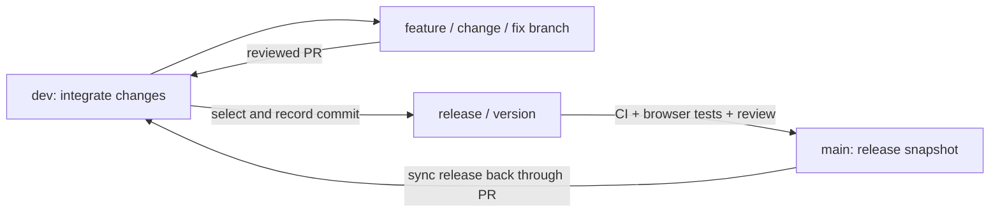

# Branching and releases

ACP is experimental. `main` contains reviewed release snapshots; `dev` is the integration branch
and can contain unfinished release work. A merge or tag does not establish production readiness.

## Where a pull request goes

| Work                                       | Start from                                       | PR target |
| ------------------------------------------ | ------------------------------------------------ | --------- |
| Feature, fix, documentation or maintenance | Current `dev`                                    | `dev`     |
| Release preparation                        | A reviewed, recorded commit reachable from `dev` | `main`    |
| Bring a merged release and its fixes back  | `main` after release merge                       | `dev`     |



These are repository contribution conventions. They do not change the branch templates ACP offers
for tickets in another project. Naming and PR-base rules are review requirements; this change adds
no automated naming enforcement or GitHub branch protection.

## Branch names

Use lowercase kebab-case for the area and description: `<type>/<area>/<short-description>`.
Use an area such as `web`, `server`, `core`, `db`, `adapter`, `docs` or `ci`. Include an issue
number in the description when useful, for example `fix/server/123-pending-approval-race`.

| Type      | Use                                                              | Example                              |
| --------- | ---------------------------------------------------------------- | ------------------------------------ |
| `feature` | Adds a user-facing capability                                    | `feature/web/project-map-status`     |
| `change`  | Documentation, refactoring or maintenance                        | `change/docs/contributor-onboarding` |
| `fix`     | Corrects existing behavior                                       | `fix/server/pending-approval-race`   |
| `release` | Maintainer-only release candidate; version is the second segment | `release/0.4.1`                      |

Legacy `wp/*`, `docs/*`, `feat/*` and other existing branches do not need to be renamed. Use the
new convention for new work. Branch names and Conventional Commit types are separate: a
`change/docs/...` branch can contain `docs: ...` commits.

## Start a contribution

For a maintainer with write access (`origin` is this repository):

```bash
git fetch origin
git switch -c change/docs/clearer-setup origin/dev
```

For a fork (`origin` is your fork, `upstream` is the ACP repository), add `upstream` once:

```bash
git remote add upstream https://github.com/keerthivibisan/agent-control-plane.git
git fetch upstream
git switch -c change/docs/clearer-setup upstream/dev
```

Make a focused change, run the applicable checks, then push to your repository:

```bash
git push -u origin change/docs/clearer-setup
```

Open the PR against **ACP's `dev` branch**, even if GitHub initially selects `main`. Explain what
changed, why, the real validation results and any remaining limitations. Reconcile newer `dev`
changes before review; do not rewrite another contributor's branch or force-push shared branches.

## Prepare a release

Maintainer procedure; `0.4.1` below is an example, not the selected next release.

1. Finish review on `dev` and select the exact commit to release. Record its full SHA in the PR
   and release scope. Confirm it includes all intended changes and the previous release metadata.
2. Fetch, capture the selected commit and create the release branch. This example selects the
   current `dev` tip; replace the variable with a reviewed full SHA to select an earlier commit.

   ```bash
   git fetch origin
   ACP_RELEASE_COMMIT=$(git rev-parse origin/dev)
   git show --no-patch --oneline "$ACP_RELEASE_COMMIT"
   git merge-base --is-ancestor "$ACP_RELEASE_COMMIT" origin/dev
   git switch -c release/0.4.1 "$ACP_RELEASE_COMMIT"
   ```

3. Review the diff against `main`. If `main` includes release fixes missing from `dev`, reconcile
   them first. Update the changelog, upgrade/rollback notes and all eight package versions in
   coherent commits. Keep shared release metadata in a separate commit; do not change dependencies
   just to make a release. Document excluded planned features.
4. Open **`release/<version>` → `main`**. Run the complete CI and browser suites on the final
   candidate, review failures and obtain maintainer approval. Stabilization fixes should reach
   `dev` too; record any cherry-picked fixes and their origin. A changed candidate needs fresh CI.
5. Merge the approved release using a **merge commit**, where repository settings permit, to
   preserve ancestry between `dev` and `main`. Ordinary change PRs may be squash-merged. If a
   release is squash-merged, the next step is especially important because commit ancestry differs.
6. Tag the exact approved release commit on `main` as `v<version>` and publish the release notes
   through the maintainer's normal release process. Do not tag a moving `dev` branch or assume a
   PR merge automatically creates a GitHub Release. Tagging/publishing are explicit actions.
7. Bring the merged `main` back into `dev` through a synchronization PR, preserving ancestry with
   a merge commit. If GitHub cannot open a direct `main` → `dev` PR, start
   `change/release/sync-<version>` from `dev`, merge `main` there, resolve overlaps against the
   reviewed release, and open that branch → `dev`. Confirm `main` is an ancestor of the resulting
   `dev` and that version/changelog metadata and release fixes are present.

Pages deployment is separate: the [KT publication guide](docs/knowledge-transfer/PUBLISHING.md)
explains its manual workflow. Release merging does not publish the documentation site.

## Review and repository settings

The existing CI runs for PRs into `dev`, `main`, `dev/*` and `release/*`; browser E2E also runs
for PRs into `main`. See [.github/workflows/ci.yml](.github/workflows/ci.yml). Maintainers should
require review and green checks for the protected integration/release branches. Repository
settings and required-check enforcement are not configured by this documentation change.

Readiness check on 2026-10-28: the repository is public and `main` is the default branch. Effective
rulesets on `main` and `dev` require a PR and one approving review, and disallow deletion and
non-fast-forward updates. The effective rules returned no `required_status_checks` rule. CI runs
on PRs, but maintainers should verify that the intended checks are required before merging.
Merge commits are enabled, so the release ancestry strategy above is available.

Avoid direct pushes to `main` or `dev`. Delete merged work branches when no longer needed; keep
published release tags. Back up the database before upgrades with migrations
([START.md](START.md#stopping-and-upgrading)).
