<p align="center">
  <picture>
    <source media="(prefers-color-scheme: dark)" srcset="docs/brand/control-plane-logo-on-dark.svg">
    
  </picture>
</p>

<p align="center">
  <strong>See what your coding agents are doing, and run them from one board.</strong><br>
  Local-first, open source, for Claude Code.
</p>

<p align="center">
  
  
  
  
</p>

# Agent Control Plane

Agent Control Plane (ACP) is a local-first control plane to **observe and orchestrate Claude Code
agents**. It reads your Claude Code sessions and shows which ones are running, which agent started
which helper, and how many tokens each used. It also runs agents for you: give a ticket to a lead
agent, approve its plan, and follow its helpers, their reviews and your project's checks until you
merge the result once, locally or as a pull request on GitHub.

Why: once you run more than one coding agent, it gets hard to see what each is doing, what it costs
and what it changed, and easy to let one touch the wrong branch. ACP puts that on one board, on
your own computer: nothing leaves it, and nothing lands without your merge.

- [Feature tour](#feature-tour)
- [Quick start](#quick-start)
- [Safety and privacy](#safety-and-privacy)
- [Status](#status) and [roadmap](#roadmap)
- [How it works](#how-it-works)
- [Contributing](#contributing)

## Feature tour

**The board.** One per project, from idea to merged change.

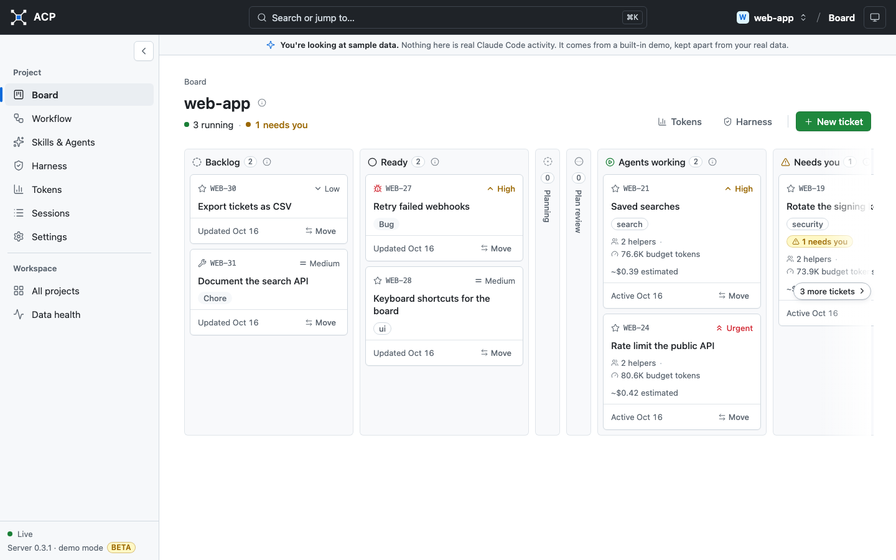

**A ticket reads like a pull request:** its branch and target, the merge box with Push & open PR,
the run options, and tabs for Comments, Agents, Files changed, Checks and Conversation.

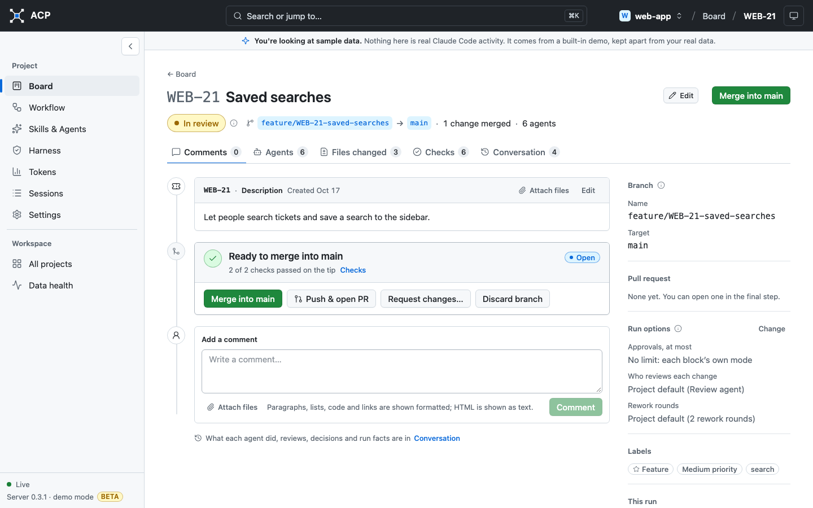

**Review the changes the way you would on GitHub:** a file tree, side-by-side diffs with syntax
colours, Viewed checkboxes, and comments on lines that go back to the agents as rework notes.

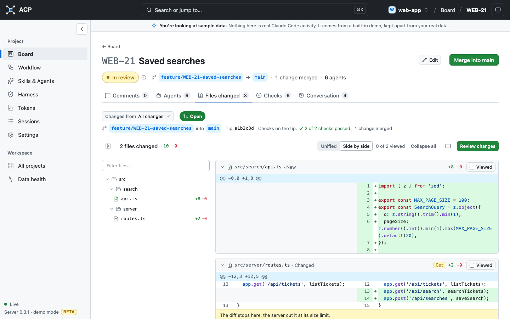

| The agents of a live run                                                                                                                                                                 | What happened, as a timeline                                                                                                               |
| ---------------------------------------------------------------------------------------------------------------------------------------------------------------------------------------- | ------------------------------------------------------------------------------------------------------------------------------------------ |
| 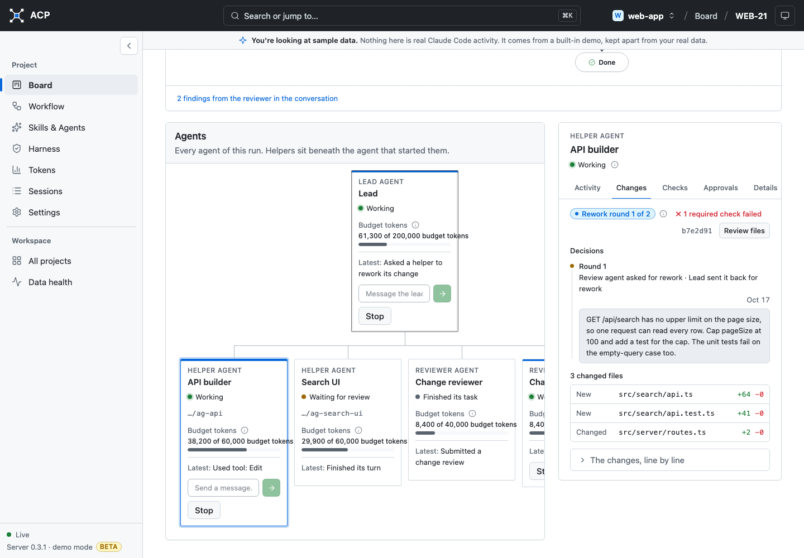                                                              | 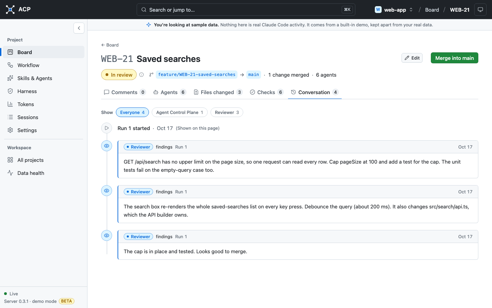                                             |
| **Your own workflow, as a graph**                                                                                                                                                        | **Branches and GitHub in Settings**                                                                                                        |
| 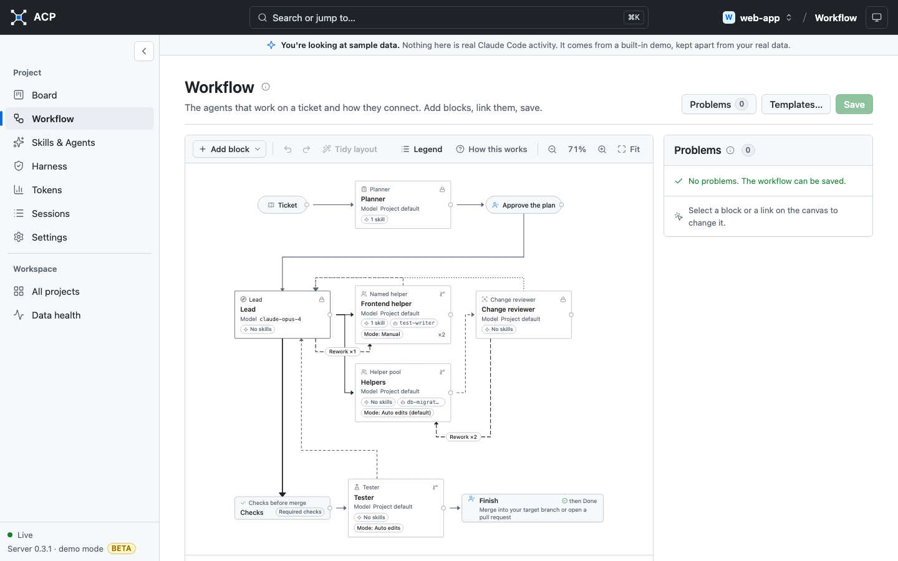 | 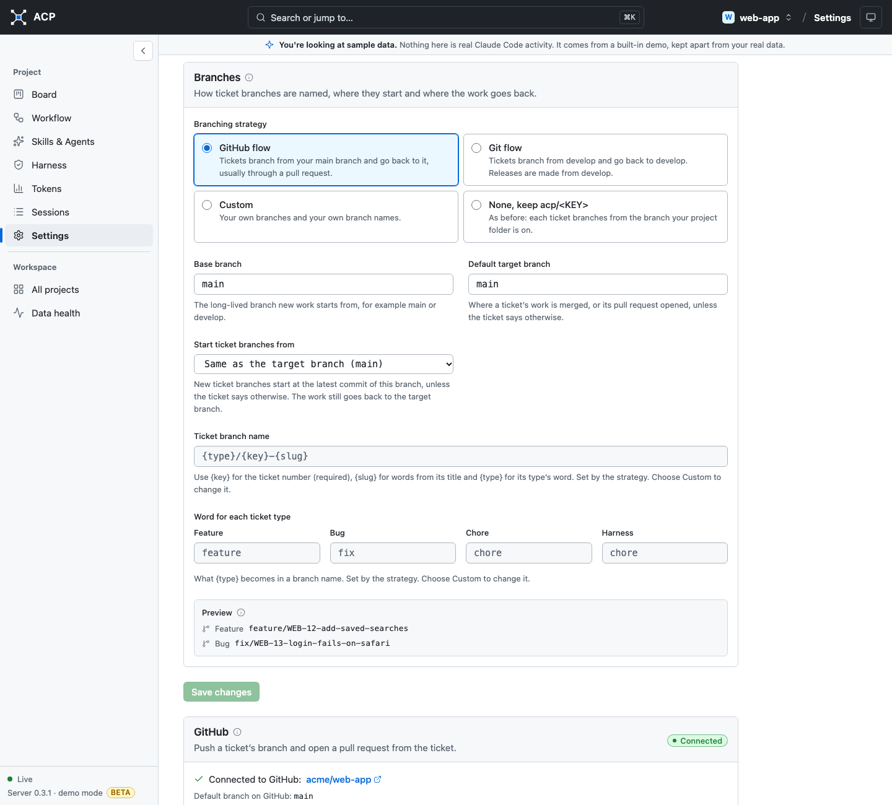 |
| **Sessions and the agent tree**                                                                                                                                                          | **Tokens: new work and cache reuse**                                                                                                       |
| 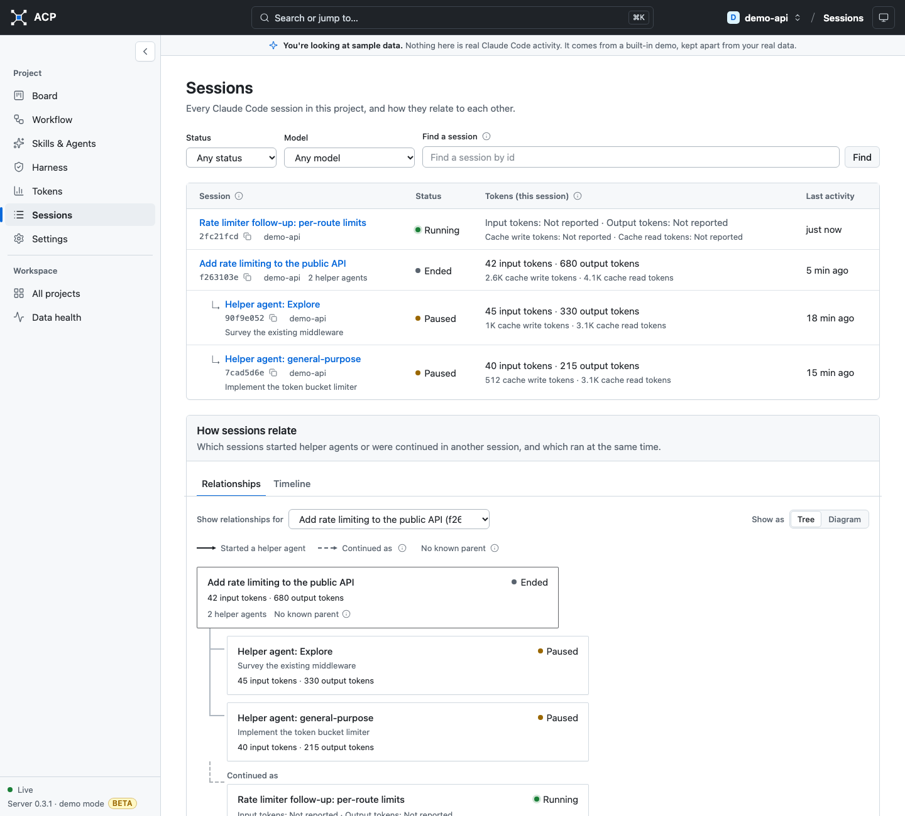                                                                                 | 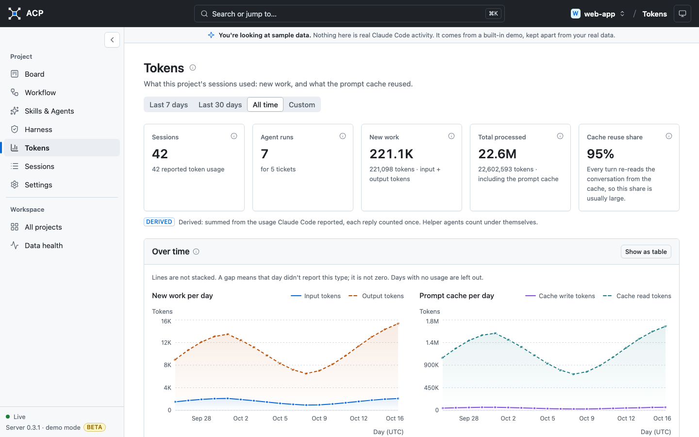                                                                            |

<details>
<summary>Dark theme</summary>

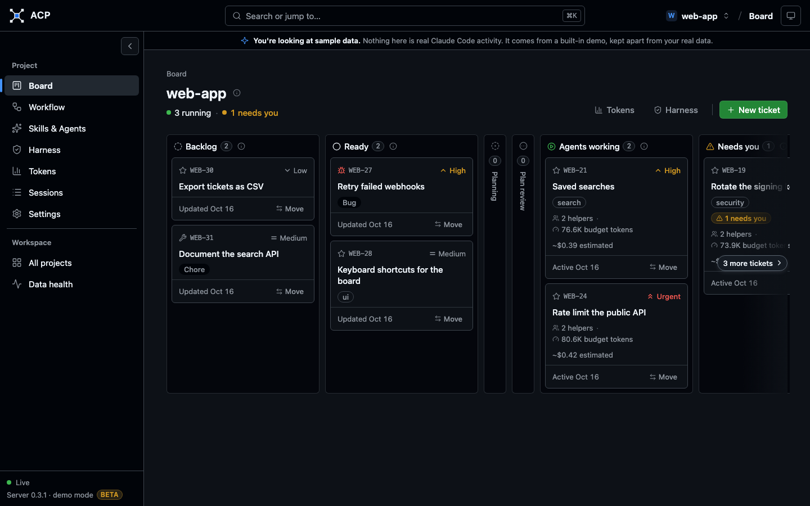

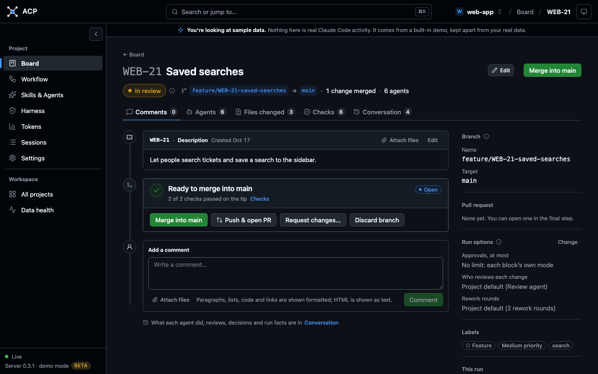

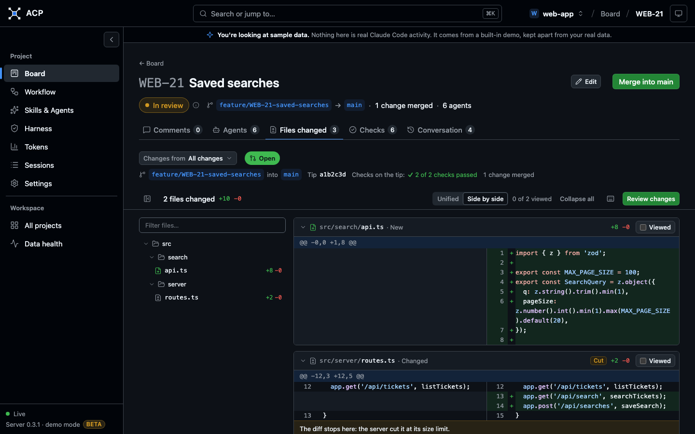

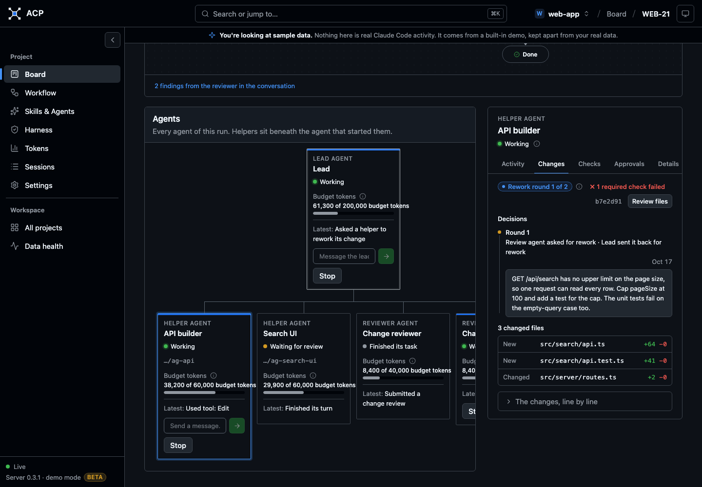

</details>

<details>
<summary>Skills and agent files</summary>

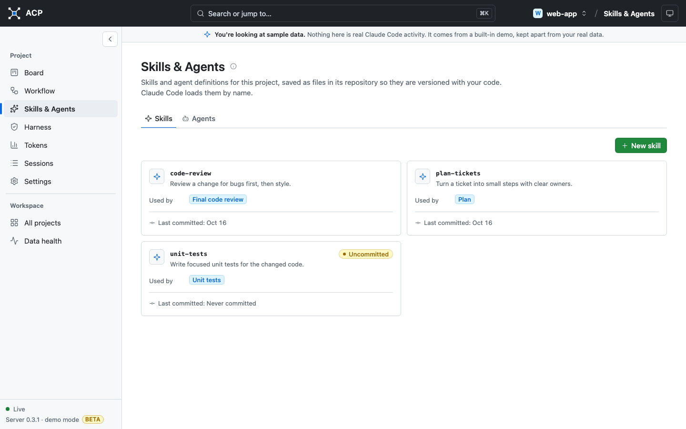

</details>

_The screenshots show sample data only: the built-in demo and synthetic tickets, not real projects.
They were taken on v0.3.1._

### Observe your Claude Code sessions

- Finds the sessions of the projects you add and keeps reading them as they grow.
- Shows which session started which helper agent, and which session continued another. A link is
  drawn only where Claude Code's own records show it; an unknown parent stays unknown.
- Counts input, output and cache tokens with each reply counted once, and labels every number as
  observed, derived, estimated or unavailable. Missing usage shows as unavailable, never as 0.
- Optional Claude Code hooks for instant "Waiting for you" and ended sessions.

### Run agents on a ticket

1. A planner proposes a plan. You approve it or ask for changes. Approving creates the ticket's own
   branch, named by the project's branching strategy (for example
   `feature/WEB-12-saved-searches`).
2. A lead agent starts helper agents for the plan's steps, each in its own git worktree.
3. Each finished change is reviewed by a read-only review agent or by the lead. The lead merges it
   into the ticket branch, sends it back for rework (2 rounds by default), discards it, or asks
   you.
4. An optional code reviewer and unit-test writer run on the ticket branch.
5. You merge the ticket branch into its target once, or push it and open a pull request.
6. Each agent leaves a short note of what it did, and the lead writes a summary on the ticket. After
   a run ends you can still ask its lead questions.

**Approval modes**, per project, ticket, run or workflow block: **Manual** (everything asks),
**Auto edits** (edits in the helper's own copy and the project's exact checks run unasked; the
default), **Auto** (plus commands you list) and **Full auto** (nothing asks; helpers run in Claude
Code's auto mode inside your operating system's sandbox). Auto-approved requests show the rule that
allowed them.

### Your own workflow for each project

- Draw how a ticket flows on the Workflow page: a planner, named helpers such as "Frontend
  helper", a helper pool, change and final reviewers, a tester, Checks blocks and the Finish
  block. Start from a template or build your own.
- Each agent block has its own model, effort (Low, Medium, High), skills, agent file and approval
  mode. A ticket's or run's mode can only make a block more careful, never less.
- Links that make no sense are refused, and no workflow can switch off a safety rule: only helpers
  and testers edit, only the lead merges into the ticket branch, and only you merge the ticket
  branch.
- The ticket page draws the run's workflow live, with each block's state and agents.

### A workspace per project

- **Board**, **Workflow**, **Sessions**, **Tokens** (by day, session, ticket, role and model),
  **Settings** and **Data health**.
- **Skills & Agents:** edit the project's `.claude/skills` and `.claude/agents` files and commit
  them.
- **Harness:** `.acp/harness.json` lists the project's checks (with labels such as `fast` and
  `full`) and up to 5 setup steps, such as installing dependencies. Setup runs in each agent's own
  copy, never in your project folder; a step that downloads runs only while you allow network use
  for the project. Checks blocks in the workflow decide where checks run and who hears about a
  failure.
- **GitHub, through your own `gh` login:** create or connect the repository, branching strategies
  (GitHub flow, Git flow or custom) with a preview, local branches, and Push & open PR, Merge pull
  request and Delete branch, each only on your click. The app never reads or stores a token.
- Attachments on tickets (up to 10 MB each); agents get read-only copies, never committed.
- Light, Dark or System theme.

## Quick start

### Prerequisites

| Tool              | Version                                        | Needed for                                      |
| ----------------- | ---------------------------------------------- | ----------------------------------------------- |
| Node.js           | 22.x, at least 22.12 (`.nvmrc` pins 22.21.1)   | everything                                      |
| pnpm              | 10.26.x                                        | everything                                      |
| git               | any recent version                             | everything                                      |
| C/C++ build tools | Xcode Command Line Tools, or `build-essential` | only if the SQLite driver has to compile        |
| Claude Code       | installed and signed in (`claude`)             | agent runs; observing and the demo work without |
| GitHub CLI (`gh`) | installed and signed in (`gh auth login`)      | optional: pull requests and the GitHub card     |

macOS and Linux are tested. Windows is untested.

### Run it

One command on macOS or Linux. It checks Node and pnpm (installing them through nvm when needed),
installs the dependencies and starts the app:

```bash
./start.sh
```

Or by hand:

```bash
pnpm install
```

```bash
pnpm dev
```

Open **http://127.0.0.1:5173** and add your first project. To look around with sample data first,
start it with `./start.sh --demo` (or `ACP_MODE=demo pnpm dev`): a separate demo database, no
access to your Claude Code data, and no agents.

Agent runs use your own Claude Code login (or API key) and count toward your Claude usage. Set
`ACP_MANAGED=off` to only observe sessions.

[START.md](START.md) covers the built app, configuration, where data lives, hooks and your first
ticket. [BUILD.md](BUILD.md) covers building and testing from source.

## Safety and privacy

- **Local only.** The server listens on `127.0.0.1`. No telemetry, no update checks, no uploads.
  Agent runs start Claude Code, which talks to Anthropic as it always does. The GitHub features use
  your own `git` and `gh` against the project's `origin`, and only when you click.
- **Read-only access to Claude Code data.** Only the session files under `~/.claude/projects`, and
  only fully for the projects you add. Credentials (`~/.claude/sessions/`), settings files and
  history are never read, and Claude Code settings are never changed.
- **No conversation content stored.** Only ids, names, models, timestamps, statuses and token
  counts, plus the text you exchange in the app: your chat with a run's lead, plans, review
  findings, agent notes, the lead's summaries and the files you attach. Diffs are never stored.
- **Agents never touch your working folder.** Each helper works in its own git worktree under the
  app's data folder. No text from an agent or a file ever reaches a shell: the app runs `git`,
  `gh`, Claude Code and your harness checks as argument lists.
- **The branch guard.** Helpers and testers can never create, switch, commit to, reset or push
  branches, in any mode, including Full auto: branch-managing `git` and `gh` commands are denied
  before they run, and in Full auto the sandbox also denies writes to the repository's `.git`
  folder. Their work is committed by the app. The app itself acts only on the ticket branch it
  recorded, and refuses `main`, `master`, the ticket's target, your strategy's long-lived branches,
  `origin`'s default branch and your checked-out branch.
- **You decide what lands.** Nothing reaches the ticket's target without your merge or your pull
  request. Budgets per agent, bounded retries, Stop and Stop all, a run timeout and safe restarts
  (interrupted work waits for you, never relaunches by itself) apply throughout.

Details: [docs/security.md](docs/security.md). Report a vulnerability privately as described in
[SECURITY.md](SECURITY.md).

## Status

**Beta.** Features and data formats may still change before 1.0.0 (database migrations run
automatically on start; back up your data folder before an upgrade). What works today:

- observing Claude Code sessions, their helper agents and token usage, live;
- projects, the board, plan-first ticket runs with a lead, helpers, reviewers and a tester;
- editable workflow graphs, approval modes up to Full auto, effort per agent;
- the harness (setup steps and checks), Checks blocks in the workflow;
- the pull-request-like ticket page, attachments, agent notes and run summaries;
- GitHub (create or connect a repository, push, open and merge pull requests) and branching
  strategies;
- the demo mode.

It is tested by thousands of unit and integration tests, a browser end-to-end suite and an
[adversarial suite](docs/testing/adversarial.md) in which fake agents misbehave on purpose. Real
runs against Claude Code are written up in [docs/research/](docs/research/).

Known limits:

- **Claude Code only.** Codex and other agents are not supported yet.
- **Costs are estimates.** Token counts are exact where Claude Code reports them; there is no
  pricing table yet, and Claude Code's own cost figures are shown as estimated.
- **Not tested on Windows.**
- **One user, one computer.** There are no accounts and no remote access, by design.

## Roadmap

Planned, in rough order (details in [docs/roadmap.md](docs/roadmap.md)):

- **Usage reliability:** a versioned pricing table and cost estimates with provenance, optional
  OpenTelemetry as a second usage source, retention and purge.
- **Harness Lab:** compare agent setups with repeated runs, baseline vs harness-assisted.
- **Codex adapter:** observe and run Codex through the same contracts.
- **Recommendations:** suggestions backed by evidence, applied only after your approval (research).

Ideas and help are welcome: see [Contributing](#contributing).

## How it works

One Node.js process on `127.0.0.1` serves the API, live updates and the web UI, and keeps its data
in a local SQLite database.

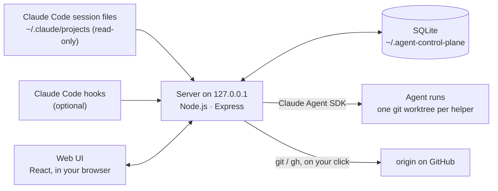

The code is a TypeScript monorepo with enforced dependency directions:

| Package                    | What it does                                                       |
| -------------------------- | ------------------------------------------------------------------ |
| `@acp/core`                | shared contracts (Zod) and pure logic; no Node or browser APIs     |
| `@acp/db`                  | SQLite, migrations, repositories                                   |
| `@acp/adapter-claude-code` | reads Claude Code sessions and hooks; runs agents through the SDK  |
| `@acp/adapter-demo`        | deterministic sample data for the demo and tests                   |
| `@acp/orchestrator`        | the pure run engine: plans, agents, the review loop, workflows     |
| `@acp/server`              | the composition root: pipeline, REST, live updates, git and GitHub |
| `@acp/web`                 | the React UI                                                       |

Read [docs/architecture.md](docs/architecture.md) for the managed-run flow, workflow graphs, the
review loop, the harness, GitHub and the branch guard, and [docs/README.md](docs/README.md) for all
the specs and the [design decisions (ADRs)](docs/decisions/README.md).

## Contributing

Contributions are welcome, from bug reports to code. Start with [CONTRIBUTING.md](CONTRIBUTING.md):
setup, `pnpm check`, tests, commit style and good first areas. If you work with a coding agent,
point it at [AGENTS.md](AGENTS.md) ([CLAUDE.md](CLAUDE.md) for Claude Code): it holds the rules
every change follows.

This app was itself built mostly by coding agents, coordinated in parallel git worktrees with a
human deciding and merging. [docs/history/](docs/history/README.md) keeps the plans, for the
curious.

Please follow the [code of conduct](CODE_OF_CONDUCT.md).

## Brand

The mark is the **Control Core**: a centre square (the control plane), four corner nodes (the
agents) and diagonal connectors. The files are in [docs/brand/](docs/brand/) (the app serves the
same files from `packages/web/public/brand/`):

| File                             | Use                                                            |
| -------------------------------- | -------------------------------------------------------------- |
| `control-plane-logo.svg`         | primary: the mark and the AGENT CONTROL PLANE wordmark, light  |
| `control-plane-logo-on-dark.svg` | the same on dark backgrounds                                   |
| `control-plane-mark.svg`         | the symbol alone (navigation, avatar), lime centre, light      |
| `control-plane-mark-on-dark.svg` | the symbol on dark backgrounds                                 |
| `control-plane-*-mono-dark.svg`  | one colour, graphite, for light backgrounds                    |
| `control-plane-*-mono-light.svg` | one colour, ivory, for dark backgrounds                        |
| `favicon.svg`                    | the browser tab: a 16-pixel grid, follows the light/dark theme |

Identity colours: graphite `#171717`, warm ivory `#F4F0E8` and signal lime `#D8FF64`. The app uses
the system font stack; no fonts are bundled. Keep the mark square and undistorted, and don't
recolour it beyond these variants.

## License

[MIT](LICENSE) ([ADR-0010](docs/decisions/0010-license.md)). Agent runs use Anthropic's
[Claude Agent SDK](https://www.npmjs.com/package/@anthropic-ai/claude-agent-sdk), installed from
npm as a dependency (not part of this repository) and covered by Anthropic's own terms.
