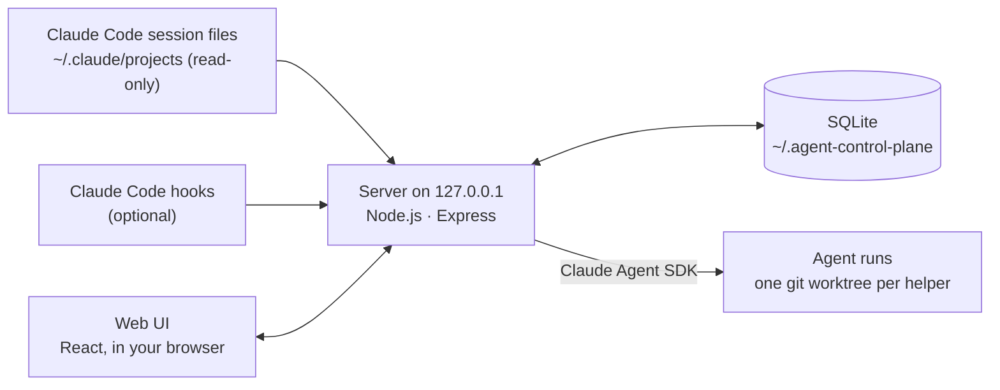

<p align="center">
  <picture>
    <source media="(prefers-color-scheme: dark)" srcset="docs/brand/control-plane-logo-on-dark.svg">
    
  </picture>
</p>

<p align="center">
  <strong>See what your coding agents are doing, and run them from one board.</strong><br>
  Local-first, open source, for Claude Code.
</p>

<p align="center">
  
  
  
</p>

# Agent Control Plane

Agent Control Plane is a local web app for working with AI coding agents. It reads your Claude Code
sessions and shows which ones are running, which agent started which helper, and how many tokens
each used. It also runs agents for you: give a ticket to a lead agent, approve its plan, and follow
its helpers, their reviews and the checks until you merge the result once.

Everything runs on your computer. The server listens on `127.0.0.1` only, there is no telemetry, and
your conversations with Claude Code are not stored.

> **Status: v0.2.0 (preview).** Features and data formats may still change before 1.0.0. Claude Code
> is the first supported agent; Codex support is planned. The latest real runs against Claude Code
> passed on 2026-10-21 ([report](docs/research/wg-v-real-run-2026-10-21.md)).

## What it does

The board: one per project, from idea to merged change.


A ticket with a live run: the lead agent, its helpers and the review agents, and each change with
its state, its checks and the reviewer's findings.


| Your own workflow, as a graph                                                                                                                                                            | Sessions and the agent tree                                                                              |
| ---------------------------------------------------------------------------------------------------------------------------------------------------------------------------------------- | -------------------------------------------------------------------------------------------------------- |
|  |  |
| **Tokens: new work and cache reuse**                                                                                                                                                     | **Skills and agent files**                                                                               |
|                                                                                                                           |                                     |

<details>
<summary>Dark theme</summary>


</details>

_The screenshots show sample data only: the built-in demo and synthetic tickets, not real projects._

## Features

**Observe your Claude Code sessions**

- Finds sessions in the projects you add and keeps reading them as they grow.
- Shows which session started which helper agent, and which session continued another. A link is
  drawn only where Claude Code's own records show it.
- Counts input, output and cache tokens with each reply counted once, and labels every number as
  observed, derived, estimated or unavailable. Missing usage shows as unavailable, never as 0.
- Optional Claude Code hooks for instant "Waiting for you" and ended sessions.

**A workspace for each project**

- **Board** of tickets, from Backlog to Done.
- **Workflow:** draw the agents that work on a ticket and how they review each other's changes
  (see below).
- **Skills & Agents:** edit the project's `.claude/skills` and `.claude/agents` files and commit
  them.
- **Harness:** the checks a change must pass before it is merged.
- **Tokens:** what the project used, by day, session, ticket, role and model.
- **Sessions**, **Settings** and **Data health**.

**Agent runs on a ticket**

1. A planner proposes a plan. You approve it or ask for changes. Approving creates the ticket's own
   branch (`acp/<KEY>`).
2. A lead agent starts helper agents for the plan's steps, each in its own git worktree.
3. Approval modes per project, ticket or run: **Manual** (everything asks), **Auto edits** (edits in
   the helper's own copy and the project's exact checks run unasked; the default for new projects),
   **Auto** (plus commands you list) and **Full auto** (nothing asks; helpers work in Claude Code's
   auto mode inside your operating system's sandbox). Auto-approved requests show the rule that
   allowed them.
4. Each finished change is reviewed by a read-only review agent or by the lead. The lead merges it
   into the ticket branch once its required checks pass, sends it back for rework (2 rounds by
   default), discards it, or asks you.
5. An optional read-only code reviewer and a unit-test writer run on the ticket branch. Then you
   merge the ticket branch into main once, or merge anyway with a reason, request changes, or
   discard it.
6. After a run ends, you can still ask its lead questions.

**Guardrails:** every role has a fixed set of tools; budgets per agent, Stop and Stop all, a run
timeout and safe restarts apply throughout.

**Your own workflow for each project**

- Draw how a ticket flows on the Workflow page: add blocks (a planner, named helpers such as
  "Frontend helper", a helper pool, change and final reviewers, a tester) and link them. Start from
  a template ("Lead only", "Today's setup", "Reviewer ↔ helper loop") or build your own.
- Three ways to review a change: the lead reviews and merges; a review agent checks it and the
  lead decides; or the review agent sends it back to the helper until it is right, then the lead
  merges.
- Each helper block has its own model, skills, agent file and approval mode. A ticket's or a
  run's mode is a limit: it can make a block more careful, never less.
- Links that make no sense are refused, a problems list says what to fix, and no workflow can
  switch off a safety rule: only helpers and testers edit, only the lead merges into the ticket
  branch after the required checks, and only you merge into main.
- The ticket page draws the run's workflow live: each block's state, its agents and the mode it
  runs with.

## Quick start

One command on macOS or Linux. It checks Node 22 and pnpm 10.26 (installing them through nvm when
needed), installs the dependencies, and starts the app:

```bash
./start.sh
```

Or by hand, with Node 22 and pnpm 10.26 ([BUILD.md](BUILD.md#prerequisites) has the details):

```bash
pnpm install
```

```bash
pnpm dev
```

Open **http://127.0.0.1:5173** and add your first project. To look around with sample data first,
run `./start.sh --demo` (or `ACP_MODE=demo pnpm dev`) instead. Agent runs need Claude Code signed in on this computer and
use your own Claude account.

[START.md](START.md) covers the built app, configuration, where data lives, hooks and your first
ticket.

## Build from source

```bash
pnpm check
```

It runs the format check, lint, typecheck, about 3,900 unit and integration tests, and the build.
The browser end-to-end suite (about 60 tests) runs separately. See [BUILD.md](BUILD.md).

## How it works

One Node.js process on `127.0.0.1` serves the API, live updates and the web UI, and keeps its data in
a local SQLite database.



The code is a TypeScript monorepo: shared contracts and logic (`@acp/core`), the database
(`@acp/db`), the Claude Code reader (`@acp/adapter-claude-code`), the run engine
(`@acp/orchestrator`), the server (`@acp/server`) and the web UI (`@acp/web`). See
[docs/architecture.md](docs/architecture.md).

## Privacy and safety

- **Local only:** the server binds `127.0.0.1`. No telemetry, no update checks, no uploads. Agent
  runs start Claude Code, which talks to Anthropic as it always does.
- **Read-only access to Claude Code data:** only the session files under `~/.claude/projects`. The
  app reads the first 64 KB of each one to find the folder it belongs to, and reads the rest only for
  projects you added. Credentials (`~/.claude/sessions/`), settings files and history are never
  read, and Claude Code settings are never changed.
- **No conversation content stored:** only ids, names, models, timestamps, statuses and token
  counts, plus the text you exchange in the app: your chat with a run's lead, and the plans, review
  findings and lead notes kept as ticket comments. Diffs and tool output are never stored.
- **You decide what lands:** agents work in their own git worktrees, and nothing reaches main
  without your merge.

Details: [docs/security.md](docs/security.md). Report vulnerabilities as described in
[SECURITY.md](SECURITY.md).

## Roadmap

Next up: usage reliability and a pricing table, harness experiments that
compare agent setups, a Codex adapter, and recommendations backed by evidence. See
[docs/roadmap.md](docs/roadmap.md) and [CHANGELOG.md](CHANGELOG.md).

## Documentation

- [Architecture](docs/architecture.md)
- [Domain model](docs/domain-model.md)
- [Event and usage accounting](docs/usage-accounting.md)
- [Provider adapters](docs/provider-adapters.md)
- [Orchestration lifecycle](docs/orchestration-lifecycle.md)
- [Security model](docs/security.md)
- [Development](docs/development.md)
- [Research notes](docs/research/)

Design decisions are recorded as ADRs in [docs/decisions/](docs/decisions/README.md), for example
[why TypeScript](docs/decisions/0001-pnpm-workspace-and-toolchain.md),
[SQLite](docs/decisions/0003-sqlite-local-first.md) and
[the Claude Agent SDK](docs/decisions/0012-managed-execution-agent-sdk.md).

## Contributing

Read [CONTRIBUTING.md](CONTRIBUTING.md). Coding agents must follow [AGENTS.md](AGENTS.md)
([CLAUDE.md](CLAUDE.md) for Claude Code).

## Brand

The mark is the **Control Core**: a dominant centre square (the control plane), four smaller
square nodes at the corners (the managed agents) and straight diagonal connectors (coordination
and delegated work). The files are in [docs/brand/](docs/brand/) (the app serves the same files
from `packages/web/public/brand/`).

| File                             | Use                                                            |
| -------------------------------- | -------------------------------------------------------------- |
| `control-plane-logo.svg`         | primary: the mark and the AGENT CONTROL PLANE wordmark, light  |
| `control-plane-logo-on-dark.svg` | the same on dark backgrounds                                   |
| `control-plane-mark.svg`         | the symbol alone (navigation, avatar), lime centre, light      |
| `control-plane-mark-on-dark.svg` | the symbol on dark backgrounds                                 |
| `control-plane-*-mono-dark.svg`  | one color, graphite, for light backgrounds                     |
| `control-plane-*-mono-light.svg` | one color, ivory, for dark backgrounds                         |
| `favicon.svg`                    | the browser tab: a 16-pixel grid, follows the light/dark theme |

- **Colors:** the logo files keep the identity colors: graphite `#171717`, warm ivory `#F4F0E8`
  and a signal-lime `#D8FF64` centre. Since v0.3.0 the app around the logo is GitHub-like (a blue
  accent, green primary buttons, a dark top bar; `packages/web/DESIGN.md`, "Visual system"), and
  the in-app mark is drawn in the text color with an accent-blue centre.
- **Fonts:** the app uses the system font stack (nothing bundled, nothing from a CDN); the
  wordmark is uppercase, semibold and tracked. In the standalone SVGs the wordmark is live text in
  a system-safe stack (Inter, Helvetica Neue, Arial) whose width is fixed, so the lockup keeps its
  proportions with any of them.
- **Usage:** keep the mark square and undistorted, with clear space of at least one corner node
  around it; don't recolor it beyond the variants above, add effects, or use it as decoration.
  In the app, `BrandMark` and `BrandLogo` (`packages/web/src/components/BrandMark.tsx`) draw it
  from the theme's tokens.

## License

[MIT](LICENSE) ([ADR-0010](docs/decisions/0010-license.md)).
