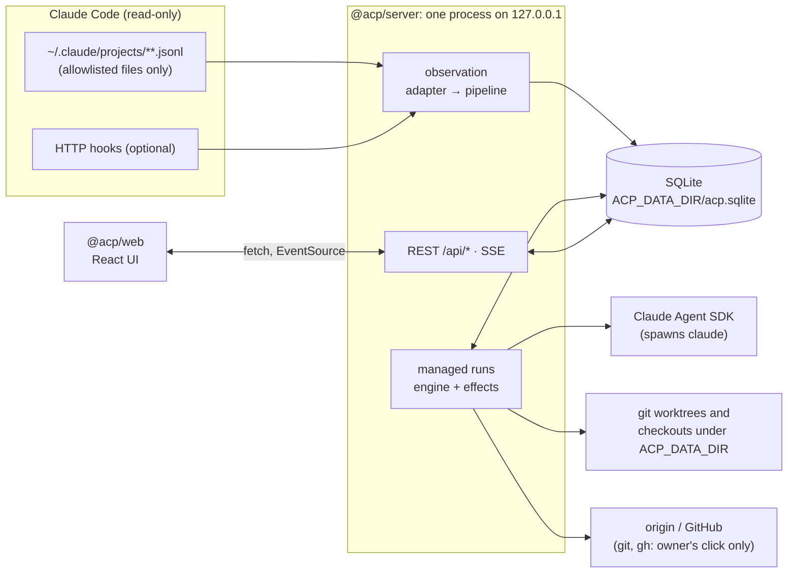
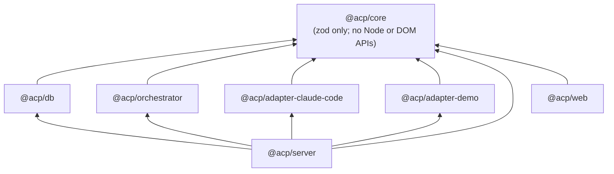
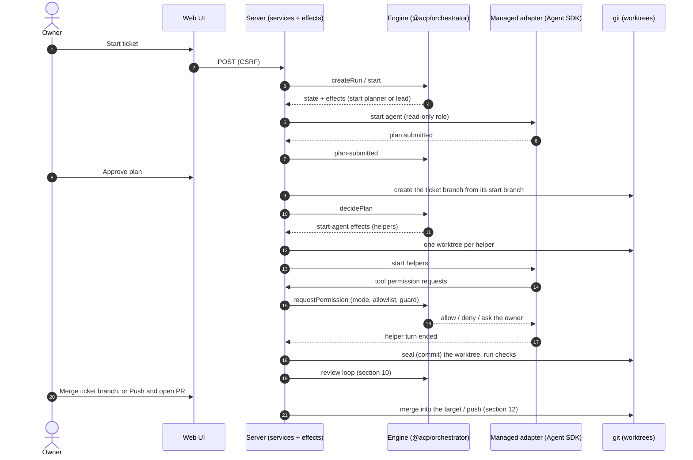
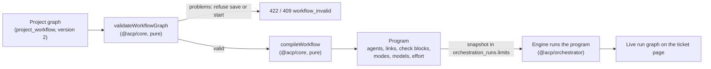
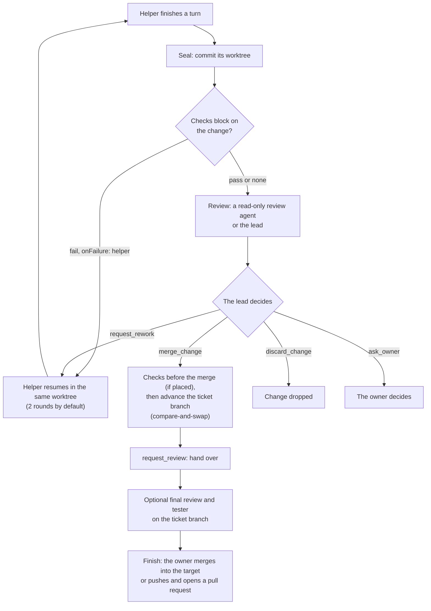
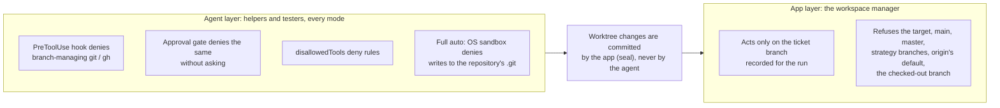

# Architecture

> **Status:** describes the code at v0.3.x (beta). Each section says whether it is
> **[implemented]** or **[planned]**; planned items are not built, even partially. Decisions are
> recorded as ADRs in [decisions/](decisions/README.md), and an ADR wins where this overview is
> shorter. The feature list is in the [README](../README.md) and the [CHANGELOG](../CHANGELOG.md).

Agent Control Plane (ACP) does two things on one computer:

1. **Observe** Claude Code sessions: read their transcript files, link sessions to the helpers they
   started, and count tokens (sections 3–7).
2. **Orchestrate** Claude Code agents: run a ticket through a plan, a lead, helpers, reviews,
   checks and one owner merge, following a workflow graph the project draws (sections 8–13).

## 1. Shape: a modular monolith (ADR-0002) [implemented]

One Node.js process serves the REST API, the server-sent events (SSE) stream, the hook receiver and
the built web UI, and runs the ingestion pipeline and managed runs in-process. It binds
`127.0.0.1` only and keeps its data in one SQLite file (ADR-0003). The modules are pnpm workspace
packages with enforced dependency directions.

## 2. Packages and dependency directions [implemented as lint rules]

| Package                    | Path                            | Responsibility                                                                                                                                                                                                    |
| -------------------------- | ------------------------------- | ----------------------------------------------------------------------------------------------------------------------------------------------------------------------------------------------------------------- |
| `@acp/core`                | `packages/core`                 | Domain types, Zod schemas, provenance, API DTOs, and pure logic: usage selection and attribution, status, path containment, redaction, workflow graph validation and compilation, the git command guard           |
| `@acp/db`                  | `packages/db`                   | SQLite connection, numbered SQL migrations with checksums, repositories, transactions, read queries                                                                                                               |
| `@acp/adapter-claude-code` | `packages/adapters/claude-code` | Observation: safe discovery, incremental JSONL reading, subagent metadata, hooks. Managed mode (`src/managed/`): agents over the Claude Agent SDK, the permission bridge, lead tools, the branch guard, Full auto |
| `@acp/adapter-demo`        | `packages/adapters/demo`        | Deterministic fixture-driven adapter for tests and the labelled demo mode                                                                                                                                         |
| `@acp/orchestrator`        | `packages/orchestrator`         | The pure run engine: run and agent state machines, plans, policy, budgets, approvals, the review loop, the compiled workflow program, check blocks. No I/O                                                        |
| `@acp/server`              | `packages/server`               | Composition root: config, the pipeline, services, routes, SSE, hooks, managed-run effects, git workspaces, the harness runner, GitHub, static UI                                                                  |
| `@acp/web`                 | `packages/web`                  | React + Vite + Tailwind UI                                                                                                                                                                                        |

`eslint.config.js` enforces the arrows (`no-restricted-imports`): `core` imports no workspace
package; `db`, `orchestrator` and the adapters import only `core`; `web` imports only `core`;
`server` imports everything except `web`. Adapters never touch the database. Changing this needs an
ADR.

Inside `@acp/server` the layering is `routes → services → repositories (from @acp/db)`. Route
handlers validate input with Zod, call one service method and map the result to a DTO; they hold no
business logic. Every mutating route needs the CSRF header (`X-ACP-CSRF`).

## 3. Event flow (observation) [implemented]

1. **Discover.** The adapter lists allowlisted transcript files under the Claude data directory
   ([provider-adapters.md](provider-adapters.md) §3). It peeks only at the first `cwd` of each
   file to decide whether it belongs to a registered project root. Files outside registered roots
   are not ingested.
2. **Read incrementally.** For each file, the adapter reads from the persisted checkpoint up to the
   last complete newline. A trailing partial line is left for the next pass.
3. **Normalize.** Each record becomes zero or more `NormalizedEvent`s (`@acp/core`), each with a
   stable `dedupKey` and a `SourceRef` (path and byte offset).
4. **Pipeline transaction.** In one SQLite transaction the pipeline:
   - validates each event with `NormalizedEventSchema`;
   - `INSERT … ON CONFLICT(dedup_key) DO NOTHING`;
   - for newly inserted events only, updates projections: sessions, edges, usage observations and
     records, and snapshots;
   - advances the file checkpoint.
5. **Publish.** Only after commit does the pipeline publish compact change notifications to SSE
   subscribers. Each carries the event row id, which SSE uses as `id:`.
6. **Hooks.** A hook POST is validated, normalized into hook-channel events and sent through the
   same pipeline. If the payload names a `transcript_path` that passes the allowlist, the adapter
   schedules an immediate read of that file, so live updates arrive faster than the polling
   interval.

A periodic scan (default 5 s, with `fs.watch` as a hint only) is the fallback. Correctness never
depends on hooks being configured.

## 4. Two-level deduplication (ADR-0006) [implemented]

- **Record level:** `events.dedup_key` is unique. Re-reading a file, restarting or receiving a
  duplicate hook inserts nothing new.
- **Fact level:** projections have natural keys: usage by `(provider, message_id)`; sessions by
  `(provider, provider_session_id, provider_agent_id)`; edges by `(kind, child)`; tool calls by
  `tool_use_id`. Two channels reporting the same fact converge on one row.

Details: [usage-accounting.md](usage-accounting.md).

## 5. Persistence [implemented]

SQLite through `better-sqlite3` (synchronous, in-process; ADR-0003):

- WAL mode, `foreign_keys=ON`, `busy_timeout`.
- Migrations are numbered `.sql` files (`packages/db/src/migrations/`, 0001–0011) applied in order
  inside a transaction and recorded with a checksum in `schema_migrations`. An applied migration is
  never edited; a change is a new migration.
- Timestamps are UTC ISO-8601 strings.
- The default location is `~/.agent-control-plane/acp.sqlite` (`ACP_DATA_DIR`). Demo mode uses a
  separate `demo.sqlite`, rebuilt on every start (ADR-0007).
- No conversation content is stored (ADR-0009). The owner-facing texts the app itself exchanges
  (the lead chat, plans, review findings, agent notes, run summaries) are the documented exceptions
  (ADR-0015, ADR-0016, ADR-0021, ADR-0024, ADR-0026).

## 6. Live updates [implemented]

`GET /api/events/stream` is SSE. Messages are small invalidation notices
(`{ kind, sessionId?, projectId? }`), not payloads; the client refetches the affected resources
through REST, so the UI never shows data that is not persisted. `Last-Event-ID` resumes from the
event row id, and a heartbeat comment is sent every 15 s.

## 6a. Renaming and re-pointing a project (`PATCH /api/projects/:id`) [implemented]

`PATCH /api/projects/:id` takes `{ name?, rootPath? }` (at least one; `UpdateProjectInput` in
`@acp/core/api`) and returns the `ProjectDto`. It renames the project and/or re-points its root
path. Only the database changes: nothing is moved, created or deleted on disk. A new root is
normalized like on registration; a root already used by another project answers 409, an unknown
project 404, an invalid body 400. After a re-point, sessions that were unassigned are matched
against the new root, and a `projects-changed` notice is published.

In project **Settings**, the Folder fact is an editor (a new absolute path and Save). When the
registered folder no longer exists on disk, the setup, harness and context views show a
missing-folder notice instead of failing, and the folder editor stays available so the path can
be fixed.

## 7. Network posture [implemented]

- The server binds `127.0.0.1` only.
- No outbound calls of its own: no telemetry, no update checks. The two exceptions are the `claude`
  process the Agent SDK starts for a managed run (ADR-0012), and, on the owner's click only, `git
push` to the project's `origin` and the GitHub CLI `gh` with the owner's own login (ADR-0025).
  Nothing runs on a timer.
- The hook receiver requires a per-install token header. Custom headers force a CORS preflight,
  which the server rejects for foreign origins, so browser pages cannot forge hook events.

See [security.md](security.md).

## 8. Managed runs [implemented]

A ticket run is driven by the pure engine in `@acp/orchestrator`. Every input (the owner's click,
an agent's tool call, an agent event) is a command `(state, input, ctx) → { state, effects }`. The
server **persists the new state first**, then carries out the effects in order: start or message an
agent through the adapter, create a git worktree, run checks, post a ticket comment. A refusal
leaves the state unchanged. The model plans and recommends; the engine enforces limits, budgets,
permissions, isolation and cancellation (ADR-0013).

- **Roles.** A planner (optional) and the lead are read-only; the lead works in the project root
  and drives the run through its own tools (`start_agent`, `merge_change`, `request_rework`,
  `discard_change`, `ask_owner`, `request_review`). Helpers and the tester edit, each in its own
  worktree. Reviewers read a detached checkout. Limits: at most 6 helpers at once (the project sets
  its own limit) and an agent tree at most 2 deep (ADR-0016).
- **Launch.** The managed adapter starts each agent with the SDK's `query()` in `default`
  permission mode (never `bypassPermissions`), with a fixed tool set per role, the session name
  the app chose (ADR-0024) and the block's model and effort (ADR-0028). Tool requests come back
  through `canUseTool` to the engine's approval gate.
- **Approval modes** (ADR-0021, ADR-0022): Manual, Auto edits (edits inside the agent's own
  worktree and the project's exact checks), Auto (plus the project's command allowlist) and Full
  auto (Claude Code's auto mode inside the OS sandbox). They apply per workflow block; a ticket's or
  run's mode is a ceiling that can only tighten a block (ADR-0023). The lead never approves tool
  requests.
- **Budgets and stops.** A soft budget per agent counts output plus new input tokens (ADR-0014);
  reaching it blocks the agent until the owner raises it. Stop, Stop all and a run timeout
  (`ACP_RUN_TIMEOUT_MS`, 2 hours) cancel children first. After a restart nothing relaunches by
  itself: interrupted work becomes `NEEDS_REVIEW`.
- **The run timeout counts working time** (v0.3.1). Time a loop run spends waiting only for the
  owner (a change at `needs-owner` and no agent but the lead still working) is not counted
  (`isRunOverdue` in `@acp/orchestrator`; the waits are kept in memory only). A run whose other
  helpers keep working while one change waits keeps its clock running. When the timeout does stop a
  run, a helper whose change waits for review ends `CANCELLED`, as with Stop all, and the other live
  agents end `TIMED_OUT`.
- **Rework in a new session** (v0.3.1). A rework turn resumes the helper's saved session. If that
  resume fails before the session answered (no usage, no tool call), the adapter starts the turn
  once more in a new session, in the same worktree with the helper's earlier work, and the prompt
  says so. The engine keeps the new session id for later reworks and tells the lead, and the
  ticket gets a line for the owner.

The run and agent state machines are in [orchestration-lifecycle.md](orchestration-lifecycle.md).

## 9. Workflow graphs (ADR-0023, ADR-0027, ADR-0028) [implemented]

Each project draws its own workflow on the Workflow page from rule-checked blocks: the ticket, a
planner, the lead, named helpers, a helper pool, change and final reviewers, a tester, Checks
blocks and the Finish block (stored as `ticket-merge`, `owner-merge` and `done`).

- The same pure validator runs in the editor and on the server; a graph saves and a run starts
  only when it validates and compiles. No graph can switch off a safety rule: only helpers and the
  tester edit, only the lead merges into the ticket branch, and only the owner finishes.
- A version 1 workflow is migrated on read; a run snapshots its graph and compile context, so a
  restart compiles the same program.
- Templates: "Lead only", "Today's setup", "Reviewer ↔ helper loop".
- **Linking in the editor** (v0.3.1). A link starts from a connector on any side of a block, snaps
  onto the nearest block that accepts it, or is made by clicking a connector and then a block, or
  with "Link to…" in the block's panel or menu. Every one of these, and moving a link's end, asks
  core's `canConnect`, so the editor adds no rule of its own; when only one kind of link fits it is
  made at once. Undo and redo (50 steps) and Tidy layout are editor state only
  (`packages/web/src/features/workflow/editor/`).

## 10. The review loop and the ticket branch (ADR-0021) [implemented]

- **Plan approval** creates the ticket branch from its start branch; helpers and the tester start
  from its tip.
- **The lead merges** each accepted change into the ticket branch only; a conflict is refused with
  the file names.
- **The owner merges once.** At REVIEW the combined diff and the checks on the tip are shown; the
  owner merges, merges anyway with a reason (when a Checks block gates the tip), requests changes
  (back to the lead) or discards. The lifecycle details are in
  [orchestration-lifecycle.md](orchestration-lifecycle.md) §0.1.

## 11. The harness and checks (ADR-0017, ADR-0027, ADR-0028) [implemented]

- **The manifest.** `.acp/harness.json` in the project lists checks as argument arrays with time
  limits, labels and a `required` flag, and up to 5 setup steps. It is read from the project's own
  checkout, never from an agent's worktree.
- **The runner** (`packages/server/src/harness`, `board/checks.ts`) spawns each command with no
  shell, a bare command name, its own process group, a filtered environment and a time limit, and
  keeps only the redacted last lines of output. One check runs at a time.
- **Where they run.** Setup steps run in each editing agent's new worktree before it starts and in a
  fresh checkout before checks; never in the owner's folder, never for read-only roles. A step that
  needs the network runs only while the project's "Setup may use the network" switch is on.
- **Checks blocks** are optional and placed in the graph: on a helper's change, before the lead's
  merge, or on the ticket branch. Each selects checks (`required`, ids or labels) and says who hears
  a failure (`helper`, `lead` or `owner`). Checks gate only where a block is placed; the editor
  warns when a workflow has none.
- A branch-managing git command is never pre-approved as a check and never run by the runner.

## 12. GitHub and branching (ADR-0025) [implemented]

- **Branching strategies** (GitHub flow, Git flow, custom, or none) live in the project setup: the
  base branch, the default target, where ticket branches start, and a name template such as
  `{type}/{key}-{slug}`. A ticket can set its own name, target and start branch. Without a strategy
  the branch is `acp/<KEY>`.
- **The local merge** into the target fast-forwards a clean checkout when the target is checked out
  there; otherwise it moves only the target's ref by compare-and-swap; it is refused when the target
  is checked out in another worktree. Never forced.
- **`code-host/`** wraps one provider interface (GitHub's `gh` today): `status`, `push`,
  `openPullRequest`, `view`, merge and delete. Commands run through an injected runner (`execFile`,
  argument arrays, time limits, no prompts, stderr dropped). Pushes go to `origin`'s configured
  address, never a planted push URL, and are never forced.
- **Only on the owner's click** (CSRF): Push & open PR, Push new commits, Merge pull request and
  Delete branch. A pull request state is read when the owner opens the ticket or clicks Refresh.
  The app never reads or stores a token.
- **[planned]** other code hosts (for example GitLab's `glab`) behind the same interface.

## 13. The branch guard (F-1, F-2; ADR-0013, ADR-0025) [implemented]

Two independent layers keep agents and the app off branches they must not move.

- **Agent layer.** The command reader in `@acp/core` (`workspace/git-guard.ts`) splits a command
  the way a shell would (quotes, `;`, `&&`, pipes, subshells, `sh -c`, `eval`, wrappers such as
  `env` and `xargs`) and allows only reading git commands and changes to the agent's own files and
  index. `checkout`, `switch`, `commit`, `reset`, `merge`, `rebase`, `push`, `fetch`, ref and
  worktree writes, aliases and `-c` are denied, as are `gh pr checkout|merge`, `gh repo sync` and
  `gh api`. Research: [f-1-branch-guard-2026-10-24.md](research/f-1-branch-guard-2026-10-24.md).
- **App layer.** Every ticket-branch operation (create, advance, update from the target, merge,
  discard, push) checks the name with `GitBranchNameSchema` and the refusals above. Git runs with
  argument arrays only, serialized per worktree and per repository.
- The [adversarial suite](testing/adversarial.md) makes fake agents attack both layers.

## 14. Planned modules [planned]

None of these exist yet; do not build them outside their phase ([roadmap.md](roadmap.md)):

- **Usage reliability (Phase 2):** a versioned pricing table and cost estimation with provenance,
  optional OpenTelemetry ingestion as a second usage source, retention and purge.
- **Harness Lab (Phase 5):** repeated baseline vs harness-assisted runs and comparisons.
- **Codex adapter (Phase 6):** `packages/adapters/codex`, implementing the same core contracts. The
  `Session` and `AgentRun` split ([domain-model.md](domain-model.md)) keeps that open.
- **Recommendations (Phase 7):** research.

## Where to read next

- [domain-model.md](domain-model.md): sessions, agent runs, edges, usage and provenance.
- [usage-accounting.md](usage-accounting.md): deduplication and token accounting.
- [provider-adapters.md](provider-adapters.md): the Claude Code adapter and its file allowlist.
- [orchestration-lifecycle.md](orchestration-lifecycle.md): run and agent states.
- [security.md](security.md): the threat model and rules.
- [decisions/](decisions/README.md): ADR-0001 to ADR-0028 (accepted) and ADR-0029 (proposed).
