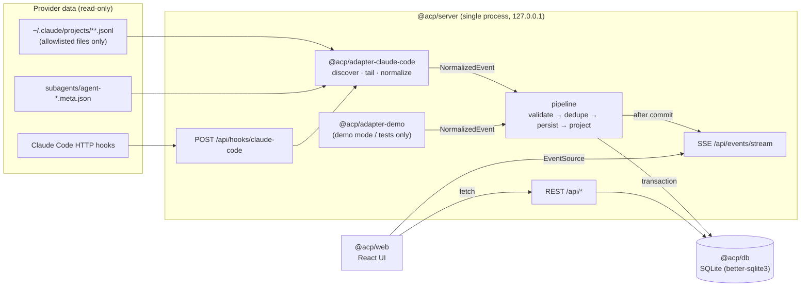

# Architecture

> Status: **Phase 0 complete.** Only `@acp/core` contracts (v1) are implemented. Everything else in this
> document is the agreed design that Phase 1 work packages implement. Sections are marked
> **[implemented]** or **[planned]**.

## 1. Shape: a modular monolith (ADR-0002)

One Node.js process serves the REST API, the SSE stream, the hook receiver, and the built web UI. It
runs the ingestion pipeline in-process. Modules are pnpm workspace packages with enforced dependency
directions.

## 2. Packages and dependency directions [implemented as lint rules]

| Package                    | Path                            | Responsibility                                                                                                                                                 | May depend on                                 |
| -------------------------- | ------------------------------- | -------------------------------------------------------------------------------------------------------------------------------------------------------------- | --------------------------------------------- |
| `@acp/core`                | `packages/core`                 | Domain types, Zod schemas, provenance, pure logic (dedup selection, attribution, aggregation, status derivation, path containment, redaction), API DTO schemas | `zod` only. No Node or DOM APIs (`types: []`) |
| `@acp/db`                  | `packages/db`                   | SQLite connection, versioned SQL migrations, repositories, transaction helper                                                                                  | `@acp/core`, `better-sqlite3`                 |
| `@acp/adapter-claude-code` | `packages/adapters/claude-code` | Safe discovery, incremental JSONL reading, subagent metadata, hook payload normalization, capability report                                                    | `@acp/core`, `zod`, Node built-ins            |
| `@acp/adapter-demo`        | `packages/adapters/demo`        | Deterministic fixture-driven adapter for tests and labeled demo mode                                                                                           | `@acp/core`                                   |
| `@acp/server`              | `packages/server`               | Composition root: config, pipeline, services, REST routes, SSE, hook receiver, static UI                                                                       | all of the above except `@acp/web`            |
| `@acp/web`                 | `packages/web`                  | React + Vite + Tailwind UI                                                                                                                                     | `@acp/core` (types/schemas only)              |

`eslint.config.js` enforces these rules (`no-restricted-imports`). Adapters never touch the database.
The web package never imports server, db, or adapter code. Changing the table requires an ADR.

Inside `@acp/server`, the layering is `routes → services → repositories (from @acp/db)`. Route handlers
validate input with Zod, call one service method, and map the result to a DTO. Route handlers contain
no business logic.

## 3. Event flow [server side implemented, P1-D; Claude Code adapter planned, P1-C]

1. **Discover.** The adapter lists allowlisted transcript files under the Claude data directory
   ([provider-adapters.md](provider-adapters.md)). It peeks only at the first `cwd` of each file to decide
   whether the file belongs to a registered project root. Files outside registered roots are not
   ingested.
2. **Read incrementally.** For each file, the adapter reads from the persisted checkpoint up to the last
   complete newline. A trailing partial line is left for the next pass.
3. **Normalize.** Each record becomes zero or more `NormalizedEvent`s (`@acp/core`). Each event has a
   stable `dedupKey` and a `SourceRef` (path and byte offset).
4. **Pipeline transaction.** In one SQLite transaction the pipeline:
   - validates each event with `NormalizedEventSchema`;
   - `INSERT … ON CONFLICT(dedup_key) DO NOTHING`;
   - for newly inserted events only, updates projections: sessions, edges, usage observations and
     records, and snapshots;
   - advances the file checkpoint.
5. **Publish.** Only after commit does the pipeline publish compact change notifications to SSE
   subscribers. Each notification carries the event row id, which SSE uses as `id:`.
6. **Hooks.** A hook POST is validated, normalized into hook-channel events, and sent through the same
   pipeline. If the payload names a `transcript_path` that passes the allowlist, the adapter schedules
   an immediate incremental read of that file. This is how live updates arrive faster than the
   polling interval.

A periodic scan (default 5 s, plus `fs.watch` as a hint only) is the fallback. Correctness never
depends on hooks being configured.

## 4. Two-level deduplication (ADR-0006)

- **Record level:** `events.dedup_key` is unique. Re-reading a file, restarting, or receiving a
  duplicate hook delivery inserts nothing new.
- **Fact level:** projections have natural keys:
  - usage by `(provider, message_id)`;
  - sessions by `(provider, provider_session_id, provider_agent_id)`;
  - edges by `(kind, child)`;
  - tool calls by `tool_use_id`.

  Two channels reporting the same fact converge on one projection row.

Details are in [usage-accounting.md](usage-accounting.md).

## 5. Persistence [implemented, P1-B]

The database is SQLite through `better-sqlite3` (synchronous, in-process; ADR-0003):

- WAL mode, `foreign_keys=ON`, `busy_timeout`.
- Migrations are plain numbered `.sql` files applied in order inside a transaction and recorded in
  `schema_migrations`.
- All timestamps are UTC ISO-8601 strings.
- Default location is `~/.agent-control-plane/acp.sqlite` (`ACP_DATA_DIR`). Demo mode uses a separate
  `demo.sqlite` file (ADR-0007).

## 6. Live updates [implemented, P1-D]

`GET /api/events/stream` is Server-Sent Events:

- Messages are small invalidation notices (`{ kind, sessionId?, projectId? }`), not full payloads.
- The client refetches the affected resources through REST, so the UI never shows data that is not
  persisted.
- `Last-Event-ID` resumes from the event row id.
- A heartbeat comment is sent every 15 s.

## 7. Network posture

- The server binds to `127.0.0.1` only.
- There are no outbound network calls at runtime. Nothing is uploaded.
- The hook receiver requires a per-install token header. Custom headers force a CORS preflight, which
  the server rejects for foreign origins, so browser pages cannot forge hook events.

See [security.md](security.md).

## 8. Future modules (not built in Phase 1)

- **Orchestration engine (Phase 3, in progress):** `@acp/orchestrator` (pure engine; scaffolded) and
  the managed-execution mode of `@acp/adapter-claude-code` over the Claude Agent SDK (ADR-0012), per
  [orchestration-lifecycle.md](orchestration-lifecycle.md) §0.
- **Workspace manager (Phase 3, in progress):** `packages/server/src/workspace/` (git worktrees,
  diff, merge on owner approval; ADR-0013). Validation runner: later (P3-G).
- **Codex adapter (Phase 5):** `packages/adapters/codex`, implementing the same core contracts.

Phase 1 must not add code for these. It only avoids decisions that would block them, for example by
keeping `Session` and `AgentRun` separate ([domain-model.md](domain-model.md)).
