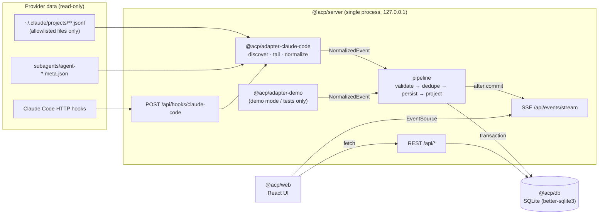

# Architecture

> Status: the code is at **v0.3.0**. Features added since v0.1.0 (editable workflow graphs, GitHub,
> the ticket page and the harness in the workflow) are described in ADR-0023 to ADR-0027. This document began as the agreed design for Phase 1; where a section says
> **[planned]**, it is not built yet. The current feature list is in the README and CHANGELOG.

## 1. Shape: a modular monolith (ADR-0002)

One Node.js process serves the REST API, the SSE stream, the hook receiver, and the built web UI. It
runs the ingestion pipeline in-process. Modules are pnpm workspace packages with enforced dependency
directions.

## 2. Packages and dependency directions [implemented as lint rules]

| Package                    | Path                            | Responsibility                                                                                                                                                 | May depend on                                 |
| -------------------------- | ------------------------------- | -------------------------------------------------------------------------------------------------------------------------------------------------------------- | --------------------------------------------- |
| `@acp/core`                | `packages/core`                 | Domain types, Zod schemas, provenance, pure logic (dedup selection, attribution, aggregation, status derivation, path containment, redaction), API DTO schemas | `zod` only. No Node or DOM APIs (`types: []`) |
| `@acp/db`                  | `packages/db`                   | SQLite connection, versioned SQL migrations, repositories, transaction helper                                                                                  | `@acp/core`, `better-sqlite3`                 |
| `@acp/adapter-claude-code` | `packages/adapters/claude-code` | Safe discovery, incremental JSONL reading, subagent metadata, hook payload normalization, capability report                                                    | `@acp/core`, `zod`, Node built-ins            |
| `@acp/adapter-demo`        | `packages/adapters/demo`        | Deterministic fixture-driven adapter for tests and labeled demo mode                                                                                           | `@acp/core`                                   |
| `@acp/server`              | `packages/server`               | Composition root: config, pipeline, services, REST routes, SSE, hook receiver, static UI                                                                       | all of the above except `@acp/web`            |
| `@acp/web`                 | `packages/web`                  | React + Vite + Tailwind UI                                                                                                                                     | `@acp/core` (types/schemas only)              |

`eslint.config.js` enforces these rules (`no-restricted-imports`). Adapters never touch the database.
The web package never imports server, db, or adapter code. Changing the table requires an ADR.

Inside `@acp/server`, the layering is `routes → services → repositories (from @acp/db)`. Route handlers
validate input with Zod, call one service method, and map the result to a DTO. Route handlers contain
no business logic.

## 3. Event flow [server side implemented, P1-D; Claude Code adapter planned, P1-C]

1. **Discover.** The adapter lists allowlisted transcript files under the Claude data directory
   ([provider-adapters.md](provider-adapters.md)). It peeks only at the first `cwd` of each file to decide
   whether the file belongs to a registered project root. Files outside registered roots are not
   ingested.
2. **Read incrementally.** For each file, the adapter reads from the persisted checkpoint up to the last
   complete newline. A trailing partial line is left for the next pass.
3. **Normalize.** Each record becomes zero or more `NormalizedEvent`s (`@acp/core`). Each event has a
   stable `dedupKey` and a `SourceRef` (path and byte offset).
4. **Pipeline transaction.** In one SQLite transaction the pipeline:
   - validates each event with `NormalizedEventSchema`;
   - `INSERT … ON CONFLICT(dedup_key) DO NOTHING`;
   - for newly inserted events only, updates projections: sessions, edges, usage observations and
     records, and snapshots;
   - advances the file checkpoint.
5. **Publish.** Only after commit does the pipeline publish compact change notifications to SSE
   subscribers. Each notification carries the event row id, which SSE uses as `id:`.
6. **Hooks.** A hook POST is validated, normalized into hook-channel events, and sent through the same
   pipeline. If the payload names a `transcript_path` that passes the allowlist, the adapter schedules
   an immediate incremental read of that file. This is how live updates arrive faster than the
   polling interval.

A periodic scan (default 5 s, plus `fs.watch` as a hint only) is the fallback. Correctness never
depends on hooks being configured.

## 4. Two-level deduplication (ADR-0006)

- **Record level:** `events.dedup_key` is unique. Re-reading a file, restarting, or receiving a
  duplicate hook delivery inserts nothing new.
- **Fact level:** projections have natural keys:
  - usage by `(provider, message_id)`;
  - sessions by `(provider, provider_session_id, provider_agent_id)`;
  - edges by `(kind, child)`;
  - tool calls by `tool_use_id`.

  Two channels reporting the same fact converge on one projection row.

Details are in [usage-accounting.md](usage-accounting.md).

## 5. Persistence [implemented, P1-B]

The database is SQLite through `better-sqlite3` (synchronous, in-process; ADR-0003):

- WAL mode, `foreign_keys=ON`, `busy_timeout`.
- Migrations are plain numbered `.sql` files applied in order inside a transaction and recorded in
  `schema_migrations`.
- All timestamps are UTC ISO-8601 strings.
- Default location is `~/.agent-control-plane/acp.sqlite` (`ACP_DATA_DIR`). Demo mode uses a separate
  `demo.sqlite` file (ADR-0007).

## 6. Live updates [implemented, P1-D]

`GET /api/events/stream` is Server-Sent Events:

- Messages are small invalidation notices (`{ kind, sessionId?, projectId? }`), not full payloads.
- The client refetches the affected resources through REST, so the UI never shows data that is not
  persisted.
- `Last-Event-ID` resumes from the event row id.
- A heartbeat comment is sent every 15 s.

## 7. Network posture

- The server binds to `127.0.0.1` only.
- There are no outbound network calls at runtime except the SDK's `claude` (ADR-0012) and, on the
  owner's request only, `git push` to the project's `origin` and the GitHub CLI `gh` with the
  owner's own login (ADR-0025). Nothing runs on a timer, and nothing else is uploaded.
- The hook receiver requires a per-install token header. Custom headers force a CORS preflight, which
  the server rejects for foreign origins, so browser pages cannot forge hook events.

See [security.md](security.md).

## 8. Future modules (not built in Phase 1)

- **Orchestration engine (Phase 3, in progress):** `@acp/orchestrator` (pure engine; scaffolded) and
  the managed-execution mode of `@acp/adapter-claude-code` over the Claude Agent SDK (ADR-0012), per
  [orchestration-lifecycle.md](orchestration-lifecycle.md) §0.
- **Workspace manager (Phase 3, in progress):** `packages/server/src/workspace/` (git worktrees,
  diff, merge on owner approval; ADR-0013). Validation runner: later (P3-G).
- **Review loop (ADR-0021) [implemented]:** the engine (`@acp/orchestrator`: `AWAITING_REVIEW`,
  change states, the lead's change tools, handover) decides; the server carries out its git effects
  (`control/review-loop.ts` with `WorkspaceManager`: the ticket branch at plan approval,
  seal, integrate, compare-and-swap advance, the owner's single `--ff-only` merge; git argument
  arrays only, serialized per worktree and per repository) and runs the harness checks per commit
  (`board/checks.ts`). The approval gate applies the run's snapshotted mode (Manual, Auto edits,
  Auto, Full auto; per workflow block since ADR-0023) to helpers and the tester; the lead never
  approves. Routes: `GET`/`POST
/api/runs/:id/ticket-branch` (CSRF on POST), `POST /api/runs/:id/review` for the owner's change
  decisions. Flow: [orchestration-lifecycle.md](orchestration-lifecycle.md) §0.1.
- **Editable workflow graphs (ADR-0023) [server, db and adapter implemented, WG-C; editor and live
  view: WG-D, WG-E]:** core validates and compiles a graph (`validateWorkflowGraph`,
  `compileWorkflow`); the engine runs the compiled program. `project_workflow` holds a version 2
  graph or a version 1 workflow (migrated on read; no SQL migration), and a run snapshots its graph
  and compile context in `orchestration_runs.limits`. Routes (thin, CSRF on mutations):
  `GET`/`PUT /api/projects/:id/workflow-graph`, `POST /api/projects/:id/workflow-graph/validate`,
  `GET /api/runs/:id/workflow-graph`; the version 1 `/api/projects/:id/workflow` answers 409 for a
  graph project. Approval modes, the Full auto gate and the launch (auto mode and sandbox, or the
  sandbox alone) are decided per agent from its block; see [security.md](security.md) §4.
- **Session names and run summaries (ADR-0024) [server and adapter implemented, v0.3.0 S-A]:**
  `control/session-names.ts` names every agent the app starts from app data only (the ticket key
  and the workflow block's label, or the role word) and `launch()` passes it as
  `ManagedAgentSpec.title`; the adapter gives it to the SDK's `title` option when a session starts
  (never on a resume). The session services fill `SessionSummaryDto.managed` from
  `agent_run_sessions` (`services/managed-sessions.ts`). `control/run-summary.ts` composes the run
  summary ticket comment (author `app`) from the records after the transition that calls for it
  (the engine's `handover-summary` effect, or a run that ends without one) and adds the merge line
  after the owner's merge. Since v0.3.0 S-C the lead's note is the comment's main text and the
  facts follow under `Details:` as short sentences; the web folds them behind a "Details"
  disclosure. No migration.
- **Branching strategies and GitHub (ADR-0025) [server and db implemented, v0.3.0 G-A]:**
  - **Naming and the target:** `workspace/ticket-branch-plan.ts` (pure) names a ticket branch
    from the ticket's own `branch.name`, else the project strategy's template
    (`renderTicketBranchName`), else `acp/<KEY>`, adding `-r<n>` when taken; its target is the
    ticket's `branch.target`, else the strategy's `defaultTargetBranch`, else the checked-out
    branch. The board checks a plan with a target or an own name before the run starts
    (`checkTicketBranchPlan`: the target must exist locally, never fetched; 409
    `target_branch_missing`), and the review loop creates the branch at plan approval from the
    target's tip. The engine accepts any safe name except `main`, `master` and other tickets'
    `acp/…` names.
  - **The guard:** the workspace manager acts only on the recorded branch and refuses the run's
    target, `main`, `master`, the strategy's branches, `origin`'s known default branch and, for
    changes, the checked-out branch (it replaced the temporary `acp/<KEY>`-only rule).
  - **The local merge** goes into the target: a fast-forward of the clean checkout when the
    target is checked out there, else a compare-and-swap of the target's ref, never touching a
    working tree; refused when the target is checked out in another worktree.
  - **`code-host/`:** a `CodeHostService` over one provider interface (`CodeHostCli`; GitHub's
    `gh` now, GitLab's `glab` later): `status` (`origin` parsed to `owner/name`, `gh` by exit
    code, the default branch from `gh repo view`), `push` (`git push` to `origin`'s own
    address, never a planted push URL (F-2), then the tracking ref and upstream; never
    forced), `openPullRequest` (link the open one for the same base, refuse one for another base,
    else push and `gh pr create`) and `view`. A `CliRunner` (`execFile`, no shell, time limits, no
    prompts, stderr dropped) is injected; tests use a fake `gh` and a local bare `origin`.
  - **Routes** (thin, CSRF on POSTs): `GET /api/projects/:id/code-host`, `POST
/api/tickets/:id/branch/pull-request` (Push & open PR, or push again and link) and `POST
/api/tickets/:id/branch/pull-request/refresh`; a pull request GitHub reports merged marks the
    ticket branch merged (`Merged via pull request #N into <target> at …`) and completes the run,
    so the ticket is Done. `TicketBranchDto.pullRequest` is filled wherever the branch is
    returned.
  - **Storage:** migration 0008 (`tickets.branch_prefs`, `ticket_branches` rebuilt without the
    `acp/*` check, the `pr_*` columns); the strategy stays in the project setup JSON.
- **Codex adapter (Phase 5):** `packages/adapters/codex`, implementing the same core contracts.

Phase 1 must not add code for these. It only avoids decisions that would block them, for example by
keeping `Session` and `AgentRun` separate ([domain-model.md](domain-model.md)).
