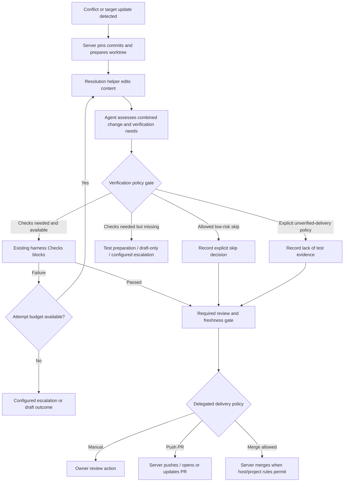

# Policy-driven conflict resolution and autonomous delivery

**Status: implemented on `feature/conflict-resolution` (2026-10-27) as
[ADR-0030](../decisions/0030-conflict-resolution-and-delegated-delivery.md), proposed.** What was
built, and what was left out, is in [README.md](README.md) and [STATUS.md](STATUS.md); this file is
the design that led to it. The original revision note follows: revised on 2026-10-27 following the
owner's clarification: ACP should let agents complete work with minimal human interruption, select
proportionate verification, and expose what was verified or deliberately skipped in the UI.

## Design position

Treat resolution, verification and delivery as separate decisions in the workflow:

- **Resolution:** combine the current target with the ticket's intended changes in an isolated
  workspace. ACP owns Git operations; agents edit content.
- **Verification assessment:** an agent evaluates the final combined diff and recommends which
  checks/review are useful, or why executable checks are unnecessary.
- **Policy gate:** deterministic code applies the project's configured rules to that recommendation.
  The agent can select among authorized paths but cannot grant itself permission or invent a pass.
- **Delivery:** promote, push/open a PR, or merge automatically when the project has explicitly
  delegated that operation and the selected path's conditions are met. Otherwise retain manual UI
  actions. Automatic resolution does not by itself authorize publishing or final merging.

A missing harness does not mean safe or unsafe; it means no project harness evidence is available.
Proceeding without it can be an explicit, reusable policy choice. It must not appear as tests passed.
Model confidence and line-count thresholds alone are insufficient evidence of behavioral safety.

A genuinely read-only ticket with no repository changes has nothing to push or merge. It can
complete with a No changes outcome. An individual helper returning no changes does not establish
that the overall ticket is read-only or complete; other changes and unresolved requirements still
need their own decisions.

## Current behavior and gaps

The inspected implementation and BackUpp/BKP-2 screenshots establish these relevant paths:

- `workspace/manager.ts:mergeOrAbort` aborts conflicts; `updateTicketFromBase` removes its temporary
  checkout instead of handing a prepared resolution workspace to an agent.
- `BranchFinalStep.tsx` hides Update from target while a PR is open.
- The read-only lead has no shell; helpers cannot merge, rebase, pull, fetch, push or alter refs.
- `reportWork` stores a helper note for the owner without forwarding the explanation to the lead.
  A no-change sealing notification lacks that result detail. Replacement-attempt accounting excludes
  no-change outcomes, permitting repeated ineffective Git-sync assignments.
- `nextStage` normally considers a final stage consumed once it ran. A changed candidate therefore
  needs an explicit fresh evidence/review selection rather than inherited stage completion.
- The harness/check blocks already exist (ADR-0027). Commit-specific check results already exist.
  The new design should extend their selection and routing, not create a competing check runner.
- The current empty required-check set passes its merge gate; that is not evidence that testing ran.
- Current ADR-0025 permits GitHub delivery only on owner actions. Unattended publishing/merging is a
  proposed extension, scoped by an explicit persisted project policy, not existing behavior.

The exact BackUpp/BKP-2 run is absent from the current local database. Its reported cleanup commit
and precise conflict contents have not been independently inspected.

## What happens without a harness?

| Situation                                                              | Proposed autonomous behavior                                                                                | Verification shown                                     |
| ---------------------------------------------------------------------- | ----------------------------------------------------------------------------------------------------------- | ------------------------------------------------------ |
| Pure prose changes within approved documentation scope                 | Resolve, assess and take the authorized skip path; deliver if permitted                                     | Checks skipped by policy: documentation-only           |
| Runtime change; allowed runner/checks exist outside a harness manifest | Run only the configured trusted checks and record their evidence                                            | Selected checks passed/failed                          |
| Runtime change; checks needed but none available                       | Route to a configured test-preparation/review path; otherwise hold or publish only as a draft if authorized | Verification unavailable                               |
| Project explicitly allows unverified delivery for this risk class      | Resolve, perform mandatory Git/policy checks, record agent assessment and deliver within that delegation    | No automated checks configured; delivered under policy |
| Always-required check is configured or the host requires it            | Satisfy it; agent cannot silently waive it                                                                  | Pending/passed/failed as actually observed             |
| Classification is uncertain or outside approved scope                  | Select a stricter permitted path, draft-only delivery, or the configured escalation action                  | Assessment uncertain / policy blocked                  |

No source extension automatically identifies a low-risk change. Markdown may be built, executed,
rendered by a generator, or contain operational instructions. MDX, documentation examples checked by
CI, scripts, configuration, dependencies, migrations and generated assets need their actual impact
considered. A one-line authorization or startup-path edit can have substantial effects.

For the screenshot's reported repository-layout change, `bash -n` only checks shell syntax. A
runtime-path/startup smoke check is proportionate even when the changed files are short or include
README text. Resolution must preserve both tickets' intended behavior rather than simply remove
conflict markers or restore directories the target intentionally removed.

## Workflow integration

Proposed typed workflow semantics (not currently available in the editor):



Configure the conflict route, resolution helper, assessment/review role, verification policy,
check selections, retry limit, missing-check outcome and delivery policy in the project workflow.
Project Settings provides defaults and the upper bounds on delegated operations. Ticket/run
settings can tighten them. Snapshot these decisions for a run/repair operation; changing project
settings does not retroactively grant broader permissions to an existing operation.

The assessment is a read-only task that the existing lead/reviewer can perform; a separate agent
process is not mandatory. It proposes a classification, impacted paths, reasons and check IDs.
It does not execute arbitrary commands or publish. Resolution uses an existing worker
kind and the configured skills/profile. No primitive agent role needs to gain raw Git authority.

Conditional skips must be explicit in the new workflow/check semantics. Existing `required: true`
checks retain their current always-required meaning on old graphs; agents cannot reinterpret them
as optional. Owners may define when new conditional checks apply. Gate selection unions all
applicable mandatory checks with agent-selected optional checks; it never removes a mandatory one.

## Project configuration

Keep the controls independent:

1. **Conflict resolution:** manual or automatic; helper selection; bounded attempts and budget.
2. **Verification:** always applicable required checks, or agent-adaptive within explicit project
   rules. Define approved skip scopes and allow/disallow unverified delivery. The default does not
   silently authorize unverified runtime delivery.
3. **Missing checks:** configured test-preparation path, draft-only output, permitted unverified
   delivery, or escalation. Missing checks need not always interrupt the owner.
4. **Review:** required reviewer/lead decisions, optional review for approved classes, and fallback
   when the original lead is no longer active. Answers-only follow-up chat stays answers-only.
5. **Delivery:** manual, push/open-update PR, or final merge. Choose allowed target branches and
   applicable risk classes; unverified delivery requires its own explicit authorization.
6. **Target freshness:** local refs initially; optional delegated origin refresh requires explicit
   network-policy amendments. Do not quietly treat stale local refs as the current remote target.

Suggested setup presets can populate those controls, but labels such as Full auto must not imply
permissions broader than their persisted fields. Current editing approval modes and sandbox rules
remain separate from project delivery delegation.

Automatic remote operations are performed by server code using validated argument arrays and the
owner's existing git/gh login, scoped to the registered project's own origin and configured target.
No arbitrary remote, credential access, forced push or repository-protection bypass is added. This
needs an ADR-0025/network-policy amendment before implementation; no remote operation was performed
while preparing this proposal.

## Repair and verification invariants

1. Pin ticket tip, local/known target tip, merge base and operation policy. Refuse duplicate repair
   operations on one ticket. Existing repository locks remain in place.
2. Build a private candidate in an isolated worktree; preserve the recorded ticket tip until its
   promotion decision. The server owns merge/stage/commit/abort and branch advancement.
3. Supply the helper with ticket intent, pinned commits, relevant versions and conflict paths.
   Adjacent file changes are allowed within the existing editing rules when needed for compatibility.
4. Confirm no unresolved Git entries; surface suspected leftover conflict markers. This structural
   validation runs even on a test-skip or explicitly unverified path.
5. Assess the **entire combined diff**, not just conflict-marked files, against the pinned target.
   The policy gate validates the assessment's scope and all applicable hard requirements.
6. If checks are selected, run the trusted setup and project check definitions against the exact
   candidate commit. Agent-edited check definitions cannot lower their own gate. Error, failure,
   timeout, interruption or an applicable required check that did not run is not pass.
7. Bind assessment, selected checks, skip authorization, review and delivery authorization to the
   candidate commit, target commit and policy/check-plan fingerprint. A changed candidate or target
   invalidates the decision. Do not reuse an old skip just because no test command ran.
8. Reuse relevant review/tester configurations with a new evidence generation when the selected
   policy requires them; do not reuse their previous consumed-stage state. A low-risk policy may
   explicitly omit optional review without claiming it occurred.
9. Count blocked/no-progress attempts across the operation; replacement helpers cannot reset the
   counter. Retry automatically while allowed, then follow the configured failure route.
10. Promote the ticket branch by compare-and-swap, rechecking freshness. Delivery follows the
    explicit project/ticket/run delegation and host rules. Automatic merge cannot infer authorization
    merely from automatic conflict resolution or an agent's confidence. Remote delivery must match
    the approved candidate/PR head; an unknown network outcome needs reconciliation before retry,
    and completion requires confirmed delivery rather than merely starting the command.
11. Preserve current restart safety: interrupted non-idempotent work is not automatically relaunched;
    reconcile recorded commits/ref updates before a later explicit continuation. Do not convert
    restart policy into silent duplicate publication.
12. Store only operation metadata and permitted owner-facing assessment/result notes. No raw worker
    conversation, diffs, prompts or conflict-file contents are persisted in events/DB/logs.

GitHub repository rules remain authoritative for remote delivery. A local policy cannot claim a
host-required check was satisfied merely because ACP skipped it. GitHub can require reviews,
status checks and up-to-date branches; its exact configured rules still decide merge eligibility.
See [GitHub's protected-branch documentation](https://docs.github.com/en/enterprise-cloud%40latest/repositories/configuring-branches-and-merges-in-your-repository/managing-protected-branches/about-protected-branches).

## UI and decision provenance

Show repair, verification and delivery independently. For example:

| Dimension    | Example statuses                                                                                           |
| ------------ | ---------------------------------------------------------------------------------------------------------- |
| Resolution   | Detected, preparing, resolving attempt 1/2, resolved, failed                                               |
| Verification | Assessing, running selected checks, checks passed, checks failed, skipped by policy, not configured, stale |
| Review       | Pending, agent reviewed, owner reviewed, skipped by policy, unavailable                                    |
| Delivery     | Waiting, pushing, PR opened/updated, merging, merged, blocked by host/policy                               |

Examples of owner-visible explanations:

- **Docs-only · checks skipped by policy.** Prose-only changes inside the approved docs scope; no
  executable/runtime/build/configuration changes detected. Agent rationale and matched rule shown.
- **Selected checks passed on candidate abc123.** List actual check names, results and commit.
- **No automated checks configured.** Agent-reviewed; delivered under the project's explicit
  unverified-delivery rule. Never label this tested or verified.
- **Checks failed · repairing automatically, attempt 2 of 2.** No immediate human interruption
  while a permitted repair route remains.
- **Target changed · reassessing.** Old assessment/check/skip evidence is stale.

Keep a concise decision explanation, matched rule, selected/omitted check IDs and reasons, candidate
and target commit IDs, and policy snapshot. Persist owner-facing summaries in the permitted scope,
not hidden chain-of-thought. A completed delivery can be successful while verification explicitly
says skipped or unavailable; do not conflate those dimensions.

## Revised proposed contracts (not applied)

Concrete initial shape for coordinator review; workflow migration/edge semantics must be finalized
alongside it rather than duplicated in server/UI types:

```ts
// New workspace/conflict-resolution.ts; exported through core's public API.
export const ConflictResolutionPolicySchema = z.object({
  mode: z.enum(['manual', 'auto']).default('manual'),
  maxAttempts: z.number().int().min(1).max(3).default(2),
  helper: WorkflowNodeIdSchema.nullable().default(null),
});

export const VerificationPolicySchema = z.object({
  mode: z.enum(['required', 'agent-adaptive']).default('required'),
  // Patterns are validated by a shared repo-relative path matcher.
  skipScopes: z.array(RepoRelativePatternSchema).max(20).default([]),
  allowUnverifiedDelivery: z.boolean().default(false),
  onMissingChecks: z.enum(['prepare-tests', 'draft-pr', 'escalate']).default('escalate'),
});

export const DeliveryPolicySchema = z.object({
  mode: z.enum(['manual', 'push-pr', 'merge']).default('manual'),
  allowedTargets: z.array(GitBranchNameSchema).max(20).default([]),
});

export const VerificationAssessmentSchema = z.object({
  candidateCommit: GitCommitSchema,
  targetCommit: GitCommitSchema,
  classification: z.enum(['prose-only', 'runtime', 'configuration', 'uncertain']),
  recommendation: z.enum(['run-checks', 'skip-checks']),
  proposedCheckIds: z.array(HarnessCheckIdSchema).max(20),
  reason: z.string().trim().min(1).max(1500), // permitted owner-facing explanation
});
```

The new repo-pattern/check-ID helpers above are proposed types, not existing exports. Path rules,
content-sensitive classification, required-check selection, permitted unverified classes and
host restrictions are validated centrally; merely matching a glob is not a behavioral proof.

Add project setup and update-request fields for the three policies, plus bounded validated operation
DTOs and state. Old setup rows and old graphs retain current semantics; partial updates preserve
fields. Add typed verification-policy and conflict-routing graph semantics, including the finite
outcome routes (run, approved skip, missing-check handling, retry, delivery). Existing role limits,
permissions and restart protections still apply.

Proposed operation endpoints remain start/status/cancel/promote under
`/api/runs/:id/conflict-resolution`. Owner-triggered mutations require CSRF. Automatic transitions
must use the same pure engine commands with persisted delegated authorization, not call endpoints
with a copied token or bypass their policy checks.

## Architecture and persistence impact

- Core domain/API schemas and graph validator/compiler need coordinated changes. The current graph
  language does not already express arbitrary conditional branches or automatic owner-merge bypass.
- Project setup is JSON; additive settings alone do not need a new column. Durable operation,
  assessment, selected-check, evidence-generation and delivery-attempt records need a new reviewed
  migration. Never edit an applied migration; back up live data before applying a new one.
- Amend the accepted orchestration, review, graph and code-hosting decisions to distinguish a direct
  owner action from explicit project-level delegated authorization. This also changes the meaning of
  the currently mandatory owner-delivery gate; it cannot be implemented only by changing UI labels.
- Affected packages: core, db, orchestrator, server, managed Claude adapter and web. No product edits
  or shared-contract changes have been made during this proposal revision.

## Acceptance scenarios

1. Parallel overlapping tickets resolve against a pinned newer target, preserving both behaviors;
   owner checkout untouched. Clean target updates also enter assessment/policy selection.
2. Approved prose-only changes take a skip path and automatically deliver when delegated. UI shows
   skipped by policy, never a fabricated passing check.
3. Runtime behavior in a Markdown/MDX file, script, generated doc, dependency/configuration file or
   a small security-sensitive change cannot qualify from its extension/line count/confidence alone.
4. Missing harness with explicit unverified authorization can deliver within scope and records no
   automated validation. Without that authorization, take the configured prepare-tests/draft/escalate
   route; do not silently merge unverified runtime code.
5. Applicable always-required checks and host requirements cannot be waived by agent output.
6. Selected checks run on the candidate; failures retry within budget. Old passes and old skip
   decisions do not authorize a changed candidate, target or policy/check plan.
7. Final review/tester configurations run fresh when required, even after original stage completion;
   optional review may be explicitly skipped only through the matched policy.
8. Automatic resolution, push and merge are independently authorized. Old projects/runs gain no new
   delivery permissions implicitly. Only configured origin/targets may receive delegated operations.
9. A target moving during assessment, checking, review or promotion invalidates stale decisions;
   compare-and-swap cannot overwrite another update. Remote staleness is reported distinctly.
10. Script/layout example passes syntax but fails startup smoke validation; it cannot be mislabeled
    docs-only and merged on the strength of a small diff.
11. Git-management tools remain denied to helpers in every mode. Blocked/no-progress attempts count
    across replacements. Stop/restart never causes duplicate/unrecorded promotion or publication.
12. UI separates resolution, verification, review and delivery and includes an owner-readable reason
    for skipped, missing, failed or stale evidence.

## Completion report — autonomy-policy design revision

1. **Summary:** replaced blanket test/review/owner-delivery requirements with policy-driven
   assessment, adaptive verification, explicit unverified paths and delegated delivery proposals.
2. **Files changed:** modified this proposal only. No product code, settings, branches, shared
   contracts, migrations or existing knowledge-base files changed.
3. **Validation:** scoped documentation formatting passed. `pnpm check` passed formatting, then
   stopped on the same 35 existing web diff-highlighting/contrast lint errors; typecheck, repository
   tests and build were not reached. No new product behavior was added to test. The prior session's
   17 check-gate tests passed and were not rerun for this documentation-only revision.
4. **Acceptance:** autonomy tradeoffs, harness-optional behavior, agent assessment, UI statuses and
   workflow integration specified; runtime feature remains proposed.
5. **Assumptions:** existing projects keep current permissions until explicitly configured; an
   agent's confidence alone grants neither a verification skip nor delivery authority.
6. **Shared changes:** updated core/API/graph/migration/ADR scope proposed above; not applied.
7. **Gaps:** exact supported path matcher, policy class rules and migration details remain subject
   to shared-contract review. No claim that skipping checks proves correctness.
8. **Next task:** finalize the shared graph/policy contracts and owned implementation packages.
