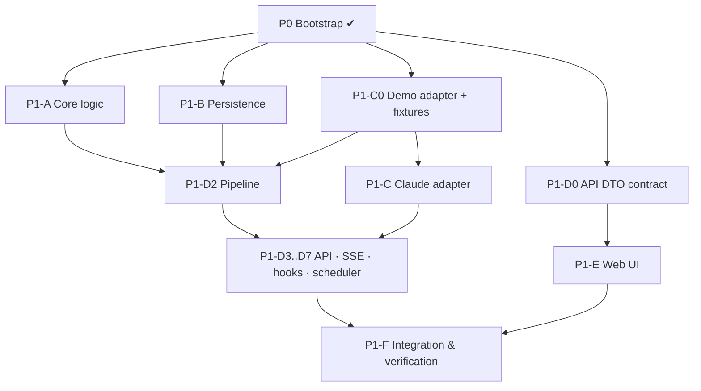

# Implementation plan — Phase 1: Session observability

This is the **authoritative task list**. Agents pick work from here, own only the files listed for their
work package (WP), and update the status table when they start and finish.
Specs: [architecture](architecture.md) · [domain model](domain-model.md) ·
[usage accounting](usage-accounting.md) · [provider adapters](provider-adapters.md) ·
[security](security.md) · [development](development.md).

## Status

<!-- Agents: update your row when you start (in-progress + branch) and when you finish (done + PR/commit). -->

| WP   | Title                                             | Owner role        | Depends on                                                      | Status                                                       | Branch                                              |
| ---- | ------------------------------------------------- | ----------------- | --------------------------------------------------------------- | ------------------------------------------------------------ | --------------------------------------------------- |
| P0   | Bootstrap: repo, tooling, core contracts v1, docs | coordinator       | —                                                               | **done**                                                     | `main`                                              |
| P1-A | Core domain logic                                 | core agent        | P0                                                              | **done**                                                     | `wp/p1-a-core-logic`, `wp/p1-a9-fork-ties` (merged) |
| P1-B | Persistence (SQLite)                              | persistence agent | P0                                                              | **done**                                                     | `wp/p1-b-persistence` (merged)                      |
| P1-C | Claude Code adapter + demo adapter + fixtures     | adapter agent     | P0                                                              | **done** (C0–C7); real hook payload capture pending approval | `wp/p1-c-adapters-2`                                |
| P1-D | Server: pipeline, API, SSE, hooks                 | backend agent     | P1-A, P1-B, P1-C (C0 first)                                     | **done** (D0–D7); live mode needs P1-C                       | `wp/p1-d-server`                                    |
| P1-E | Web UI                                            | frontend agent    | P1-D0 (API contract); P1-D running in demo mode for integration | done: E0–E5 (verified against the demo server)               | `wp/p1-e-web-2` (E3–E5; E0–E2 on main)              |
| P1-F | Integration and verification                      | coordinator       | P1-D, P1-E                                                      | todo                                                         |                                                     |

**Parallel start:** after P0, these can run at the same time, each in its own git worktree:

- P1-A
- P1-B
- P1-C (C0 first)
- P1-D0 (a small contract task)

P1-E starts once P1-D0 is merged. P1-D2 onward needs A, B, and C0.

## Integration checkpoints

| CP  | When                | What is verified                                                                                      |
| --- | ------------------- | ----------------------------------------------------------------------------------------------------- |
| CP1 | P0 done ✔           | `@acp/core` v1 contracts (events, usage, sessions, provenance, adapter contract) build and are tested |
| CP2 | P1-D0 merged        | `@acp/core/api` DTO schemas exist; the web and the server compile against them                        |
| CP3 | P1-D2 merged        | demo adapter, then pipeline, then SQLite, end to end in a test; re-ingestion is idempotent            |
| CP4 | P1-C merged + P1-D4 | the real Claude adapter ingests sanitized fixtures through the server                                 |
| CP5 | P1-F                | real local data and full acceptance checklist                                                         |

---

## P1-A — Core domain logic (complexity: M)

**Owns:**

- `packages/core/src/usage/**` (new files)
- `packages/core/src/sessions/**` (new files)
- `packages/core/src/paths/**`
- `packages/core/src/redaction/**`
- `packages/core/src/index.ts` (append exports only)
- `packages/core/tests/**` (except `contracts.test.ts`)

**Must not edit:** the existing v1 contract files listed in AGENTS.md §5, or `src/api/**` (owned by
P1-D0).

| Task | Deliverable                                                                                                                                                                    | Tests                                                                                                                                 |
| ---- | ------------------------------------------------------------------------------------------------------------------------------------------------------------------------------ | ------------------------------------------------------------------------------------------------------------------------------------- |
| A1   | `selectUsage(observations)` gives the record per the usage-accounting §5 selection rule (max output; categories from one observation; `conflict` flag; `<synthetic>` excluded) | duplicate-line growth; equal outputs; null outputs; conflicting cache counts; synthetic model                                         |
| A2   | `attributeUsage(observations)` gives the session key (earliest `occurredAt`, null last, lexical tie-break)                                                                     | fork copy attributed to the original; null timestamps; tie                                                                            |
| A3   | `sumTokenCounts(records)` and `aggregateUsage(tree)`: null-preserving per-category sums, with `recordsWithUnavailable`                                                         | all-null stays null; mixed; aggregate = direct + subagent children only; continuation children excluded                               |
| A4   | `deriveSessionStatus(evidence, now, thresholds)`                                                                                                                               | active / idle / stale boundaries; `ended`; activity after end becomes active again; no evidence gives unknown                         |
| A5   | `deriveSubagentEdge(meta, toolCallsBySession)` and `deriveContinuationEdges(observations)`                                                                                     | meta plus a matched tool use; meta only; no meta gives no edge; depth 2 matched to a subagent; depth 2 unmatched gives unknown parent |
| A6   | `isPathInside(root, candidate)` and `findOwningRoot(roots, cwd)` (pure; the caller has already called realpath)                                                                | `/repo` vs `/repo-evil`; trailing slashes; nested roots, longest wins; Windows-style paths rejected on POSIX                          |
| A7   | `redact(text)` per security.md §2.4                                                                                                                                            | positive and negative case for each pattern                                                                                           |
| A8   | Order-independence property test                                                                                                                                               | shuffled observations give identical selection, attribution, and aggregates (seeded)                                                  |

**Done when:**

- every function is exported from `src/index.ts`, pure, and documented;
- `pnpm --filter @acp/core test typecheck build` passes;
- coverage of A1–A5 includes every scenario above.

**Starter prompt:** "Implement work package P1-A from docs/implementation-plan.md. Follow AGENTS.md."

## P1-B — Persistence (complexity: M)

**Owns:** `packages/db/**`. Add `tsconfig*.json`, `src/`, `tests/`, and scripts to the existing
`package.json`, but not dependencies.

| Task | Deliverable                                                                                                                                                                                                                                                                                                                                                                                                                                                                                                                                                             | Tests                                                              |
| ---- | ----------------------------------------------------------------------------------------------------------------------------------------------------------------------------------------------------------------------------------------------------------------------------------------------------------------------------------------------------------------------------------------------------------------------------------------------------------------------------------------------------------------------------------------------------------------------- | ------------------------------------------------------------------ |
| B1   | `openDatabase(path)`: WAL, `foreign_keys=ON`, `busy_timeout=5000`, file mode 0600, directory mode 0700                                                                                                                                                                                                                                                                                                                                                                                                                                                                  | pragmas applied; file permissions                                  |
| B2   | Migration runner: `src/migrations/NNNN_name.sql`, applied in order in one transaction each, recorded in `schema_migrations(version, name, applied_at, checksum)`; refuses an edited, already-applied migration                                                                                                                                                                                                                                                                                                                                                          | fresh apply; re-run is a no-op; checksum mismatch throws           |
| B3   | `0001_observability.sql`: tables `projects`, `sessions`, `session_edges`, `events`, `usage_observations`, `usage_records`, `usage_snapshots`, `ingestion_checkpoints`, `edge_conflicts`, with FKs, indexes (`events(session_id, occurred_at)`, `events(observed_at)`, `sessions(project_id, last_event_at)`, `usage_records(session_id)`, `usage_records(model)`), and uniques (`events.dedup_key`, `sessions(provider, provider_session_id, provider_agent_id)`, `usage_records(provider, message_id)`, `session_edges(kind, child_session_id)`, `projects.root_path`) | schema snapshot test; uniqueness violations                        |
| B4   | Repositories: `projects`, `sessions` (upsert by key; min/max timestamp merging), `edges` (upsert, evidence union, conflict record), `events` (`insertIfNew` returns `{ inserted, id }`), `usage` (insert observation; read observations by message; upsert record), `snapshots`, `checkpoints`                                                                                                                                                                                                                                                                          | each repository's contract; JSON columns round-trip through Zod    |
| B5   | `withTransaction(db, fn)`; a thrown error rolls back events **and** the checkpoint                                                                                                                                                                                                                                                                                                                                                                                                                                                                                      | crash simulation: throw midway leaves no partial state             |
| B6   | Queries: session list (filters: project, provider, status inputs, model, id search; keyset pagination on `(last_event_at, id)`); session tree (recursive CTE over subagent edges); direct and aggregate usage per category, where `SUM` stays NULL when all NULL and `COUNT(*) - COUNT(col)` counts unavailable; usage grouped by project, session, model, or day                                                                                                                                                                                                       | fixtures giving known totals; null semantics; pagination stability |

Phase 3 tables are **not** created (domain-model §3).

**Done when:** `pnpm --filter @acp/db test typecheck build` passes using temp-file databases.

## P1-C — Claude Code adapter, demo adapter, fixtures (complexity: L)

**Owns:**

- `packages/adapters/claude-code/**`
- `packages/adapters/demo/**`
- `test-fixtures/**`

| Task           | Deliverable                                                                                                                                                                                                                              | Tests                                                                                                                                                |
| -------------- | ---------------------------------------------------------------------------------------------------------------------------------------------------------------------------------------------------------------------------------------- | ---------------------------------------------------------------------------------------------------------------------------------------------------- |
| **C0** (first) | Demo adapter implementing `ObservationAdapter` over committed fixtures (`provider: "demo"`, channel `demo`, deterministic clock); minimal fixture set: 2 projects, a session with 2 subagents, a fork, a session with missing usage      | determinism (two runs give identical events); every event passes `NormalizedEventSchema`                                                             |
| C1             | `scripts/sanitize-fixture.ts`: reads a transcript, keeps structure and keys, replaces ids with deterministic fakes, text with `"<redacted>"`, and paths with `/home/user/project`; output is reviewed by a human                         | sanitizer unit tests; no input text survives                                                                                                         |
| C2             | Allowlist and discovery (provider-adapters §3, §4.1); `discoverCandidates`                                                                                                                                                               | denied paths: `sessions/`, `.key`, `settings.json`, `memory/`, orphaned or superseded files, symlink escapes, oversize files                         |
| C3             | Incremental reader with checkpoints: partial lines, truncation, replacement, parse errors, chunking                                                                                                                                      | each scenario 6, 7, and 10 in usage-accounting §7                                                                                                    |
| C4             | Record normalizers per the record-type allowlist (§4.4); dedup keys per usage-accounting §3; content minimization                                                                                                                        | contract tests over sanitized fixtures, with golden expected events; scenario 1 (growth); scenario 11 (unknown types); no text fields in any payload |
| C5             | Subagent meta reading and edge evidence (§5)                                                                                                                                                                                             | meta only; meta plus a matched tool use; missing meta; synthetic depth-2 fixture (marked synthetic)                                                  |
| C6             | `normalizeHook` (§6) plus `printHookSettingsSnippet()`. **Capture real payloads** from 2.1.263 in a throwaway directory using a _project-local_ `.claude/settings.local.json`, with explicit user approval; sanitize; commit as fixtures | each subscribed hook type; invalid bodies rejected; `transcript_path` outside the allowlist ignored                                                  |
| C7             | `capabilities()` with honest `limitations`                                                                                                                                                                                               | —                                                                                                                                                    |

**Done when:**

- both adapters pass `typecheck`, `test`, and `build`;
- fixtures follow `test-fixtures/claude-code/README.md`;
- every unverified assumption is listed in `docs/provider-adapters.md`.

## P1-D — Server (complexity: L)

**Owns:**

- `packages/server/**`
- `packages/core/src/api/**` (D0 only; coordinator review)
- the root `package.json` `dev` script (D7; coordinator review)

| Task                                            | Deliverable                                                                                                                                                                                                                                                                                                                                                                                                                                                      | Tests                                                                                        |
| ----------------------------------------------- | ---------------------------------------------------------------------------------------------------------------------------------------------------------------------------------------------------------------------------------------------------------------------------------------------------------------------------------------------------------------------------------------------------------------------------------------------------------------- | -------------------------------------------------------------------------------------------- |
| **D0** (first, small) — **done by coordinator** | `packages/core/src/api/**`, exported as the pre-declared subpath `@acp/core/api` (entry `src/api/index.ts`; do not touch `src/index.ts`): Zod DTO schemas and types for every Phase 1 response (`ProjectDto`, `SessionSummaryDto`, `SessionDetailDto` with `directUsage`/`aggregateUsage`/`parent: {state: "known", …} \| {state: "unknown"}`, `SessionTreeDto`, `EventDto`, `UsageSummaryDto`, `CapabilitiesDto`, `CandidateRootDto`, `ErrorDto`, `PageDto<T>`) | schema tests                                                                                 |
| D1                                              | `loadConfig()` (development.md §5) and `createApp(deps)`, which is testable without listening                                                                                                                                                                                                                                                                                                                                                                    | config validation                                                                            |
| D2                                              | Pipeline `ingestBatch(batch)`: validate, then insert if new, then project (sessions, edges, usage observations, then recompute the record for affected message ids via `selectUsage`/`attributeUsage`, snapshots), then checkpoint, all in one transaction; then publish                                                                                                                                                                                         | scenarios 2, 5, 8; re-ingest twice gives identical totals; crash mid-batch                   |
| D3                                              | Ingestion scheduler: poll loop and hook-triggered reads; single-flight per file                                                                                                                                                                                                                                                                                                                                                                                  | no concurrent reads of the same file                                                         |
| D4                                              | REST routes (below) with Zod validation, `X-Request-Id`, the error middleware, and keyset pagination                                                                                                                                                                                                                                                                                                                                                             | supertest per route; 400/404 shapes                                                          |
| D5                                              | SSE `/api/events/stream`: invalidation messages after commit; `Last-Event-ID`; 15 s heartbeat; cleanup on disconnect                                                                                                                                                                                                                                                                                                                                             | receives a notice after ingest; never before commit                                          |
| D6                                              | Hook receiver: token file creation (0600), constant-time compare, size limit, 204 response, CORS rejection                                                                                                                                                                                                                                                                                                                                                       | missing or wrong token gives 401; oversize gives 413; a browser-origin preflight is rejected |
| D7                                              | Static serving of the web build; root `pnpm dev` (server and web in parallel)                                                                                                                                                                                                                                                                                                                                                                                    | smoke test                                                                                   |

Routes:

- `GET /api/health`
- `GET /api/overview` (Command Center aggregate; `OverviewDto`)
- `GET /api/capabilities`
- `GET /api/projects`
- `POST /api/projects`
- `GET /api/projects/:id`
- `GET /api/projects/:id/sessions`
- `GET /api/discovery/candidates`
- `GET /api/sessions?projectId&provider&status&model&q&cursor&limit`
- `GET /api/sessions/:id`
- `GET /api/sessions/:id/tree`
- `GET /api/sessions/:id/events?cursor`
- `GET /api/sessions/:id/usage`
- `GET /api/usage/summary?groupBy=project|session|model|day&from&to&projectId`
- `GET /api/events?cursor`
- `GET /api/events/stream`
- `POST /api/hooks/claude-code`
- `GET /api/diagnostics/ingestion`

Run routes (`/api/runs/*`) and approvals are **Phase 3**.

## P1-E — Web UI (complexity: L)

**Owns:** `packages/web/**`.

| Task | Deliverable                                                                                                                                                                                                                                                               | Tests                                                 |
| ---- | ------------------------------------------------------------------------------------------------------------------------------------------------------------------------------------------------------------------------------------------------------------------------- | ----------------------------------------------------- |
| E0   | Vite, React, and Tailwind scaffold; typed API client that parses every response with the D0 schemas; `useEventStream` (SSE invalidation, then refetch); app shell with dark/light themes; persistent **DEMO DATA** banner when `capabilities.provider === "demo"`         | client parse failure is shown, not swallowed          |
| E1   | Command Center: projects; session counts by status; recent events; total observed usage by category; latest provider-reported cost labeled _estimated_; "needs attention" from Notification hooks; empty states that explain how to register a project or configure hooks | renders from fixture DTOs; no hardcoded numbers       |
| E2   | Session Explorer: React Flow graph built from `/tree` (expand/collapse; nodes show agent type, model, status, tokens, last seen); unknown parent shown explicitly; filters for project, provider, status, and model; session-id search; list view                         | graph built only from edges; unknown-parent rendering |
| E3   | Session detail panel: metadata with provenance badges, direct vs aggregate usage side by side, event timeline; plus a cross-session **timeline (Gantt) view** of concurrency                                                                                              | `null` renders "unavailable", never 0                 |
| E4   | Usage analytics (Recharts): tokens over time per category; by project, session, or model; cache categories separate; snapshot cost labeled estimated                                                                                                                      | estimated values are never styled as authoritative    |
| E5   | Project workspace page: metadata, root path, sessions, usage totals                                                                                                                                                                                                       | —                                                     |

Components are data-driven and small, under `features/<screen>/`. Shared UI lives in `components/`.

## P1-F — Integration and verification (complexity: M)

| Task | Deliverable                                                                                                                                                                                             |
| ---- | ------------------------------------------------------------------------------------------------------------------------------------------------------------------------------------------------------- |
| F1   | `scripts/reference-usage.py` (or `.ts`): an independent recomputation of per-session totals directly from JSONL using the usage-accounting §5 rules. Totals must equal the API's                        |
| F2   | Real-data run on this machine: register a project, ingest, and compare with F1; compare with `cost-state` snapshots and record the findings (Q3)                                                        |
| F3   | Re-ingest (delete checkpoints, re-run): totals unchanged. Restart mid-ingest: no duplicates                                                                                                             |
| F4   | Live check: start a new Claude Code session in a registered project, then see it appear (polling, and hooks if configured); stop it, then it becomes `stale` (or `ended` with hooks), never "completed" |
| F5   | Playwright e2e in demo mode covering the brief's first end-to-end workflow                                                                                                                              |
| F6   | Update README status, docs "implemented" markers, and the acceptance checklist below                                                                                                                    |

### Phase 1 acceptance checklist (all must be checked by P1-F with evidence)

**Session discovery**

- [ ] A real session is discovered.
- [ ] Project association uses verified path containment.
- [ ] Sessions started outside the control plane are observed.
- [ ] An unknown parent stays unknown.

**Relationships**

- [ ] Meta creates an edge.
- [ ] Missing meta creates no guessed edge.
- [ ] Edges are stable across re-ingestion.

**Usage**

- [ ] Duplicate message ids don't inflate usage.
- [ ] Snapshots are never summed.
- [ ] Missing usage stays unavailable.
- [ ] Hook and transcript channels don't double-count.

**Recovery**

- [ ] Re-ingestion leaves totals unchanged.
- [ ] A restart creates no duplicates.
- [ ] Partial lines are safe.
- [ ] Stale is never shown as completed.

**Frontend**

- [ ] The UI shows real persisted data.
- [ ] The hierarchy is inspectable.
- [ ] Timeline and usage views work.
- [ ] Direct and aggregate usage are distinguishable.
- [ ] Provenance and unavailable values are visible.
- [ ] Demo data is separated.

**Security**

- [ ] Credential files are excluded (a test proves it).
- [ ] Access is limited to registered roots.
- [ ] Logs are redacted.
- [ ] User config is never modified.

**Quality**

- [ ] `pnpm check` passes.
- [ ] CI is green.

## Risks

| Risk                                                                      | Mitigation                                                                                                         |
| ------------------------------------------------------------------------- | ------------------------------------------------------------------------------------------------------------------ |
| Transcript format changes between versions (it is documented as internal) | tolerant per-field parsing; unknown-type diagnostics per version; fixtures per version; OTel as a Phase 2 fallback |
| Snapshot scope unknown, so totals don't match the provider's figures      | label snapshots as estimated; document the cross-check finding (Q3)                                                |
| Hook errors visible to users when the server is down                      | hooks are opt-in; the snippet uses `timeout: 2`; the docs explain this                                             |
| Large transcript directories (hundreds of MB)                             | chunked reads; checkpoints; size cap; discovery peeks at 64 KiB maximum                                            |
| Agents working in parallel drift from the contracts                       | ownership table; contract files locked to the coordinator; CP2/CP3 checkpoints                                     |
