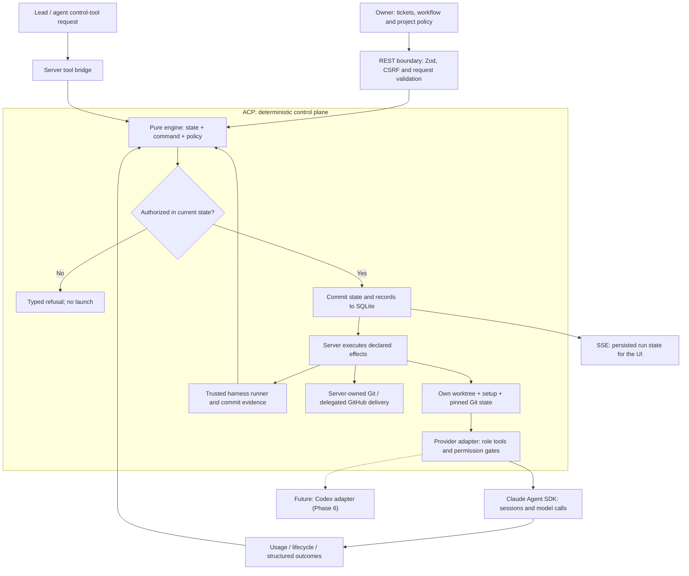
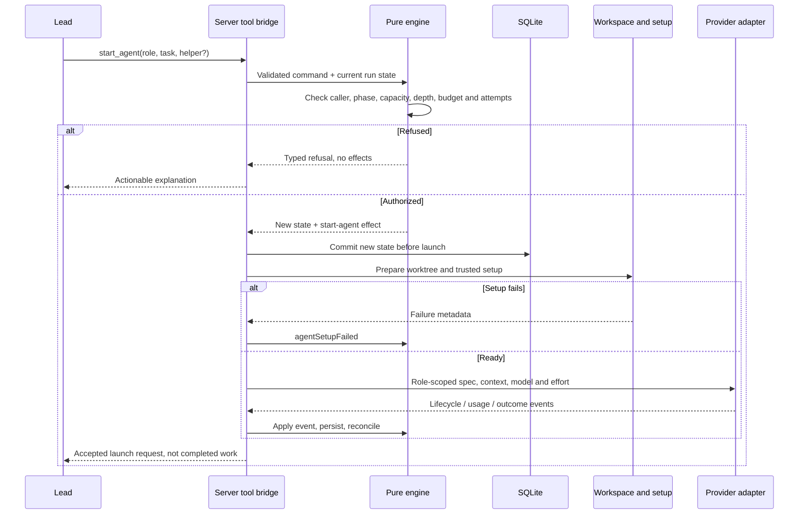

# ACP — architecture and knowledge transfer

A code-grounded guide to how Agent Control Plane turns a ticket into coordinated, policy-controlled
agent work. For engineers taking over ACP and readers evaluating its design.

**Baseline:** `dev` at `df9cf44f713e11c62add3786e6026aaee8022495` (2026-10-27). Package version 0.3.1;
this development snapshot also includes the merged conflict-resolution implementation. This guide
is a snapshot of code, not a guarantee that every described path is released or production-proven.

**Read visually:** open [site/index.html](site/index.html). Buildless, offline, responsive, and ready
to publish as a static GitHub Pages artifact. No ACP server, database, login or API key is required.
The static guide cannot start agents or change a project.

## Architecture: who decides and who executes?

The **lead chooses useful work**. The **engine authorizes state transitions** under current policy.
The **server persists state and performs I/O**. The **adapter enforces role tools and mediates the
provider process**. The model does not grant itself permissions. Agents request integrations;
server-owned Git changes refs only through the guarded operation paths.

The dotted provider extension is a proposal. Claude Code is the current managed provider; Codex is
planned in Phase 6. No additional integration or release commitment is implied.

## The helper authorization sequence

Engine authorization is only one layer. Workspace safety, trusted setup, built-in tool permissions,
Git guards, commit-specific verification and final delivery policy are separate checks. An accepted
`start_agent` call is not proof that the SDK started or the task finished.

## Read in order

| Chapter                                    | Purpose                                                                           |
| ------------------------------------------ | --------------------------------------------------------------------------------- |
| [01 · Engine and authorization](ENGINE.md) | State, commands, effects, persistence, tool gates and concrete refusals           |
| [02 · Ticket and workflow](WORKFLOWS.md)   | Handoff, launch, helpers, integration, reviews, optional checks and Finish        |
| [03 · Conflict recovery](CONFLICTS.md)     | What is implemented on this baseline, policy routes and remaining limits          |
| [04 · Token efficiency](TOKENS.md)         | 24 risks, numerical examples, provider caching and our engineering recommendation |
| [05 · Issues and tradeoffs](ISSUES.md)     | Open mechanisms, historical fixes, impact, evidence and suggested priorities      |
| [06 · Future integrations](FUTURE.md)      | Provider versus model, Codex, unconfirmed agents, conformance and rollout         |
| [Evidence and maintenance](EVIDENCE.md)    | Source map, scope, provenance and how to keep the guide current                   |
| [Publishing](PUBLISHING.md)                | GitHub Pages artifact, preview and deployment preparation                         |
| [LinkedIn draft](LINKEDIN.md)              | Public-facing copy with accurate limits and no invented savings                   |
| [Completion report](COMPLETION.md)         | Actual checks, scope, limitations and handoff                                     |

## Current features and historical mitigations

Earlier failure mechanisms need to be distinguished from the present code:

- Checks blocks are now optional and agent blocks support effort (ADR-0028).
- Conflict recovery is present, including a content-only resolver, policy assessment, pinned
  evidence, promotion and explicitly delegated delivery.
- Structured helper outcomes reach the lead; no-change helpers count against replacement bounds.
- Automated remote PR merging is **not** implemented by delegated conflict delivery; its merge
  route is local fast-forward when appropriate. PR delivery opens or updates the PR.
- Local target refs are not automatically refreshed from origin. Automatic recovery is triggered
  by supported reads/events, not a continuously running background scheduler.

The ADR-0030 file still says **proposed**, and its status table still says **review**, although the
implementation is in this baseline. This guide reports both facts; it does not accept or rewrite an
ADR. Reconcile these governance records separately.

## Public sharing boundary

The site contains architecture explanations, sanitized historical arithmetic and clearly labeled
synthetic examples. It contains no live project inventory, private screenshots, local machine paths,
provider session identifiers, credentials or conversation transcripts. Publish only `site/`, never
the repository root or a live ACP checkout directory. Markdown source references require repository
access; the visual guide works without that access.

No site has been deployed by this change, and no social post has been published.
