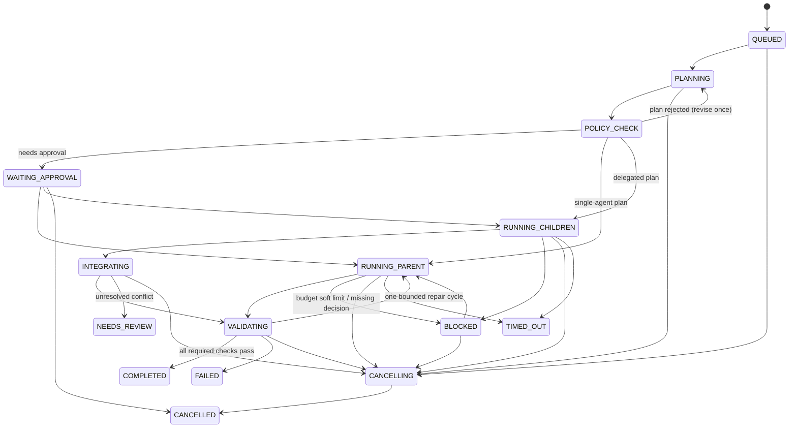

# Orchestration lifecycle

> **Release review note:** This document includes owner-only delivery wording written before
> conflict recovery was merged in v0.4.0. ADR-0030 remains marked proposed and its relationship
> to existing safety authority needs maintainer review. For implemented behavior and known limits,
> see [conflict-recovery status](conflict-resolution/STATUS.md) and the
> [release scope](releases/0.4.0.md#previously-planned-scope-and-release-review).

> **Current:** §0 (the run and agent states, built in Phase 3 milestone M1) and §0.1 (the review
> loop and the ticket branch, ADR-0021) describe how runs work today; workflow graphs (ADR-0023)
> and Checks blocks (ADR-0027, ADR-0028) decide which agents and checks a run has, see
> [architecture.md](architecture.md) §8–§11. §1 holds. §2–§5 are the original Phase 3 design,
> kept as background: where they differ from §0 and §0.1, those win. ADR-0012 (Agent SDK),
> ADR-0013 (guardrails), ADR-0014 (budget) and ADR-0015 (chat storage) narrow this design. ADR-0025
> (branching) and ADR-0028 (optional Checks blocks, the Finish block) amend §0.1, as noted there.

## 0. Milestone M1 [implemented]

- **Shape.** One run per conversation in the control panel: a **lead** agent (chats with the owner,
  read-only in the project root, has the lead tools) and up to 3 **worker** agents (one task each, own
  worktree, no lead tools). There is no separate PLANNING/POLICY_CHECK step: every `start_agent`
  call is a plan step that the engine checks against policy before anything starts.
- **Run states (M1):** `QUEUED → RUNNING ⇄ BLOCKED → REVIEW → COMPLETED`, plus `FAILED`,
  `CANCELLING → CANCELLED` and `NEEDS_REVIEW` (after a restart). `REVIEW` = every worker stopped and
  the owner is reviewing; `COMPLETED` = the owner merged or discarded every worker's changes.
- **Agent states:** `QUEUED → STARTING → RUNNING ⇄ WAITING_APPROVAL`, `RUNNING → BLOCKED` (budget),
  and terminal `SUCCEEDED | FAILED | CANCELLED | TIMED_OUT | NEEDS_REVIEW`.
- **Integration (M1):** per-worker review in the panel (diff + changed files); Merge into a clean base
  branch or Discard, always by the owner (ADR-0013). No automatic merging, no validation runner yet
  (P3-G).
- **Budget:** ADR-0014 budget tokens per agent; reaching the soft cap → `BLOCKED` + an approval of
  kind `budget-raise`.

> **Since ADR-0021 (2026-10-17), ticket runs use the review loop in §0.1.** §0's per-worker owner
> merge still describes control-panel runs and ticket runs started before it.

## 0.1 Approval modes, review loop and ticket branch (ADR-0021) [implemented]

Verified with fake agents against the real server, real git and real harness checks (server tests in
`packages/server/tests/{board,verification/review-loop}` and the browser flow
`packages/web/e2e/review-loop-live.spec.ts`). A consented real run on
2026-10-17 found two bugs ([research note](research/rl-v-real-run-2026-10-17.md)), since fixed;
the real runs of 2026-10-21 passed with every review route
([research note](research/wg-v-real-run-2026-10-21.md)).

- **Approval modes, snapshotted per run.** Each editing block of the workflow has its own mode, or
  the project's default mode (Workflow page, project defaults) when it has none; the ticket's and
  the Start dialog's modes are ceilings that can only tighten a block (ADR-0023 §5). A ticket's run
  options can also set the reviewer and the rework limit. Only helpers and the tester are covered;
  the lead never approves tool requests.
  - _Manual:_ every edit and command asks the owner, harness checks too.
  - _Auto edits_ (default for new projects): an Edit/Write whose real path is inside the helper's
    own worktree (not under `.git` or `.claude`) and a Bash command that exactly matches a harness
    check run unasked.
  - _Auto:_ Auto edits plus the project's command allowlist (safe tokens only, a bare first word,
    `git` read-only). Each auto-approved request is recorded with its rule (`allowRule`).
- **Several planners** (ADR-0037 §4): every planner submits a plan option; plan review opens once
  each has submitted or ended, and the owner approves one option (never automatically, even in
  Full auto). It becomes the run's plan; the others are stored as not chosen.
- **Research before planning** (ADR-0037 §2–3): read-only researchers wired to a planner (or to
  the lead when it plans) start first, in parallel within the helper limit and in arrow order
  along a chain; the planner starts once each has reported its findings or ended. A researcher
  wired to the lead after planning is started by the lead with `start_agent`; its findings reach
  the lead as a notice. Findings and arrow purposes reach agents only as quoted data.
- **Arrow notes** (ADR-0037 §2, amended 2026-11-14): the label and purpose of every arrow reach
  the agent it concerns: `implement` the helper's start brief and rework prompts (and the lead's
  helper list), `plan` and a plan-path `flow` the planner's (or lead's) brief, `review` the change
  reviewer's brief, `findings` the lead's verdict notice, `rework` the rework prompt from that
  reviewer, the lead or the Checks block, `test` and a final-chain `flow` the stage's brief.
  Arrows between steps reach nobody. A program without notes briefs exactly as before.
- **Custom hand-offs** (ADR-0037 §2): when the source agent is done, its output note goes to the
  target, in its start brief or as a notice; a target the engine starts waits for its sources.
- **Plan approval** creates the ticket branch from its start branch: named by the project's
  branching strategy, or `acp/<KEY>` (`acp/<KEY>-r<n>` for a later run) without one (ADR-0025).
  The lead hears of the approval only once the branch exists. Helpers and the tester start
  from the ticket branch tip, each in its own worktree. Plan steps name helper roles only.
- **A helper's turn ends:** the agent goes to `AWAITING_REVIEW` (no process, no helper slot), its
  worktree is committed (sealed) and, when the workflow places a Checks block on the change, its
  checks run on that commit (ADR-0027, ADR-0028).
- **Review fan-out** (ADR-0037 §5): a change with several reviewers waits for every verdict. Any
  `rework` means rework (straight back to the helper on a direct route while rounds are left);
  otherwise the lead decides, told each verdict and each "no verdict". Nothing merges on a partial
  set of verdicts.
- **Review:** a read-only review agent (default; it gets a detached checkout of the sealed commit
  and a diff of at most 64 KiB in its brief, sent, never stored) or the lead reviews the oldest
  ready change first. The review agent's findings become a ticket comment.
- **The lead decides** with `merge_change`, `request_rework` (comments), `discard_change`
  (reason) or `ask_owner` (question):
  - merge: integrate the tip into the helper's worktree (a conflict is refused with the file
    names); when a Checks block sits before the merge, require its checks to have passed on that
    commit (or start them; the lead hears back); then advance the ticket branch by
    compare-and-swap and release the worktree. Without that block a change merges after its
    review only (ADR-0028);
  - rework: refused past the run's limit (2 by default), over budget or with no free slot; the
    helper resumes its session in the same worktree and its change is reviewed again. If the
    resume fails before the session answered (its saved session cannot be continued), the
    adapter starts the turn once in a new session in the same worktree; the engine keeps the new
    session id, tells the lead, and the ticket gets a line for the owner (v0.3.1);
  - ask the owner: the change is `needs-owner`, and only the owner decides it (merge, merge anyway
    with a reason, rework with a comment, discard), also past the rework limit.
- **Stored text:** the review agent's findings and the lead's and owner's notes are ticket
  comments. Each round and decision is a `change_reviews` row with no text (a note on a round the
  review agent commented on has its own row).
- **Handover:** `request_review` is refused while a helper works or a change is undecided. After
  it, no helper starts; the final code review and the unit tests (if on) run on the ticket branch
  while the lead stays live.
- **Hand-over prompt (RL-F):** when the lead has not handed over, every change is decided and no
  other agent works, the engine sends the lead one message with the counts (merged into the ticket
  branch, discarded, with no changes) asking it to call `request_review` or start helpers for
  missing work; with nothing merged it says so. It is sent once per such point, again only after
  new helper or reviewer work, never after the handover, and not with the owner's "Request
  changes" message. A BLOCKED lead gets it after its budget raise.
- **The owner merges once** (the Finish block): at `REVIEW` the ticket-branch card shows the
  combined diff and, when checks gate the tip, those checks run on it (a detached temporary
  checkout). What gates the tip: a workflow with a Checks block before the lead's merge (every
  workflow saved before 0.3.1) needs the required checks; one without it needs only the checks of
  a block on the ticket branch, if it has one (ADR-0028). The owner merges into the target
  locally (a fast-forward, or a compare-and-swap of the target's ref; never forced) or pushes and
  opens a pull request (ADR-0025, architecture §12); the run is `COMPLETED` and the ticket Done.
  Merge anyway (with a reason, when checks gate the tip), Request changes (back to the lead, the
  run returns to `RUNNING`), Discard and Update from the target (when it moved) are the other
  actions.
- **Stops and restarts:** Stop all cancels waiting helpers and keeps the ticket branch (it can only
  be discarded). After a restart nothing relaunches: waiting helpers and reviewers become
  `NEEDS_REVIEW`, undecided changes `needs-owner`. The owner can merge or discard such a change but
  not yet send it back for rework (proposed in ADR-0029, not built).
- **Run timeout (v0.3.1):** the timeout (ADR-0013 §3, `ACP_RUN_TIMEOUT_MS`, 2 hours) counts the
  run's working time. While the run waits only for the owner (a change at `needs-owner` and no
  agent but the lead still working) the clock stops; it runs again after the owner's decision, and
  keeps running while other helpers work. The waits are kept in memory only: after a restart the
  run is `NEEDS_REVIEW` and never times out. When the timeout stops a run, a helper whose change
  waits for review ends `CANCELLED` (as with Stop all) and the other live agents end `TIMED_OUT`.

## 0.2 Lead and agent messaging (ADR-0033) [implemented]

Verified with engine tests (`packages/orchestrator/tests/messaging.test.ts`) and server tests with
the fake managed adapter (`packages/server/tests/control/messaging.test.ts`). Provider-neutral: the
engine and the server decide; both adapters only offer the tools (the same role sets from core,
`managedToolNames`). Not yet tried in a real run.

- **Delivery state.** `message_agent` and `ask_lead` answer with where the message stands:
  - `delivered`: handed to the agent's live process;
  - `queued`: the agent is starting and gets it once it runs;
  - `queued` (held): the agent cannot take input now (waiting for the owner, BLOCKED over budget,
    the lead waiting for an approved plan, or an ended lead between follow-up turns) and gets it in
    order when it can;
  - `dropped`, with a reason: the agent has ended, its change is under review, it only waits for its
    helpers, or it has no process. It never arrives.

  A message to an ended helper is no longer a refusal; it is reported as dropped. Every drop of any
  input (also plain input such as the owner's chat) is counted in diagnostics (`message-dropped`)
  and logged with ids only; nothing is dropped silently.

- **Held messages.** Engine notices and messages for an agent that cannot take input are held in
  memory, in order, and delivered when it can again (it leaves BLOCKED or WAITING_APPROVAL; for
  the ended lead, they open its next follow-up turn's prompt). At most 50 are held per agent; past
  that the oldest is dropped and counted (`held-message-dropped`). They do not survive a restart.
  After a budget raise the resume message comes first, then the held messages.
- **`ask_lead(question)`** (1 to 2000 characters): every helper, the tester and every reviewer
  (change and final) can ask the agent that started it: its parent helper at depth 2, else the
  lead. The parent gets `<role> (agentId <id>) asks: <question>` and answers with `message_agent`,
  which also reaches a tester or reviewer that asked. The asker keeps working. At most 5 questions
  stay open per agent; a further one is refused (`too-many-questions`) until the parent's next
  `message_agent` to it, which answers them all. The lead and the planner do not have it.
- **Finish notice.** When a helper, the tester or a reviewer stops working (finished, failed or
  stopped), its parent gets one notice with its role, the outcome and where its work is, never the
  agent's text. None is sent while the run is stopping, after a restart, to the agent that stopped
  it itself (`stop_agent`), or to a parent helper stopped in the same command. In a review-loop run
  the lead already hears of each change through the loop (ready for review, the review agent's
  verdict, a stopped helper's work), so a change-tracked agent and a change reviewer add no second
  notice to the lead.
- **`get_review_findings(agent)`** (lead, review-loop runs): the latest stored review agent findings
  of a change (round, reviewer, verdict, findings text) from the `change_reviews` row and its ticket
  comment. Refused when none are stored.
- **Bounded merge.** A merge (the lead's `merge_change` or the owner's) waits at most 10 minutes for
  the merge queued before it and for its required checks' gate. On timeout nothing is merged, the
  change keeps its state (the lead may merge again, rework, discard or ask the owner) and the lead
  is told; it is counted (`merge-timeout`). A running git command is never cut off: only these
  waits are bounded.
- **Outbox (metadata only).** Each run keeps, in memory, the latest 200 lead/agent messages as
  metadata: id, sender (an agent run or `engine`), recipient, kind (`message`, `question`,
  `notice`), state, created and delivered times, the text's length and its SHA-256. Never the text;
  nothing goes in the database. The run detail returns it as `outbox` while the run is held in
  memory and has entries.

## 0.3 Provider per agent (ADR-0031) [implemented on `feat/codex-integration`]

Each agent takes its provider (Claude or Codex) from its workflow node, else the project's
default, else Claude, when it starts, and keeps it. Its starts, rework turns, session link, usage
and the lead's follow-up all carry that provider; the server routes each to that provider's
adapter only. The state machines below are the same for both providers. Details:
[provider-adapters §12](provider-adapters.md).

## 0.4 Failure routing (ADR-0038) [implemented on `feature/workflow/failure-routing`]

Verified with core, engine, server, adapter and web tests (`failure-routing*.test.ts`, the
adversarial F-1 to F-6). One consented real run is still to come.

- **Events.** `tests-failed` (a tester's `report_test_results` with status `failed`),
  `checks-failed` and `harness-failed` (a Checks block, on a change or before the merge),
  `review-rework` (a change reviewer) and `merge-conflict` (the ticket merge, and conflicts with
  the target branch, ADR-0030).
- **Context.** Each event builds one `FailureContext`: where it happened, the change, the likely
  authors, what failed (tests, a capped check output tail, findings, conflicting files) and the
  rounds. The lead always gets it; a fixer gets the same text. All of it is quoted data.
- **Routing.** The router looks for the owner's When arrow for that source and event:
  - none: the path from before ADR-0038 (the lead decides; a rework arrow or "back to the helper"
    reworks the change as before); a tester's failure never goes back to the tester;
  - to the lead: the lead gets the context and the arrow's purpose, and decides;
  - to a helper block: a fix turn. The failing change's own helper reworks it when it belongs to
    that block and is not decided; otherwise a new helper of the block starts from the ticket
    branch with the block's settings, and the failing change waits for the lead's decision;
  - to Author: as a helper block, for the one known author; several or no known authors go to the
    lead.
- **Rounds.** Counted per When arrow and failure lineage. A fixer's own later failure keeps the
  lineage of the fix it was started for, so a chain of new fixers cannot get fresh rounds. After
  `maxRounds` fix turns the failure goes to the lead. A fix that cannot start now (no free helper
  slot, no room in the block, the helper busy or over budget, the run not going) goes to the lead
  with the reason; nothing is queued.
- **The lead steps in.** Every fix notice names its `fixId`. `reroute_fix` stops the fix and moves
  it to another helper block or the author (same round: moving uses no round; at most one move to
  a helper per round), or the lead takes it over. `stop_agent` stops it. Refused, with nothing
  changed, for an unknown or finished fix, a target that is not a helper block, or a caller that is
  not the lead.
- **The lead knows the workflow.** Its first brief has "Your workflow": every agent and arrow as a
  sentence with the owner's labels and purposes quoted; `view_workflow` returns the same text.
- **In memory.** Fixes and rounds live with the live run; after a restart nothing relaunches, as
  for every other turn.

## 1. Principles

- The LLM plans and recommends. **The engine enforces** concurrency, budgets, permissions, workspace
  isolation, cancellation, and validation. The model is never trusted to enforce its own limits.
- Success means the integrated result passes its required validation checks. A successful child does
  not mean the run succeeded.
- Every state transition is persisted before it is published.

## 2. Run state machine

Guarantees:

- Cancellation first stops new scheduling, then aborts active work (the Agent SDK uses
  `AbortController`). Cancelling a parent cancels its children.
- After a restart the engine resumes from persisted state. It **never automatically relaunches**
  non-idempotent agent work; it marks that work `NEEDS_REVIEW` instead.
- A missing heartbeat never implies success.

## 3. Structured plan (validated before execution)

Required fields:

- summary;
- strategy (`single` | `delegated`) and the rationale;
- child tasks, each with id, role, objective, expected outputs, read/write scope, and dependencies;
- integration strategy;
- validation strategy.

The engine rejects a plan that has:

- more than 3 children;
- a delegation depth above 1;
- a dependency cycle;
- overlapping write scopes without isolation;
- missing required fields.

## 4. Budget (open question Q1, resolved by ADR-0014)

> Resolved: ADR-0014 counts output, uncached input and cache-write tokens (cache reads are tracked
> and shown, never counted), as a soft limit per agent (default 500,000). The text below is the
> original question.

The draft brief proposes a 50,000-token soft budget per run. **Local data shows cache-read tokens in the
billions for long sessions.** A single turn re-reads the full context. A budget that counts cache reads
would be used up almost at once. Options to decide by ADR, using Phase 1 and 2 measurements:

1. Budget output plus uncached input tokens. Track cache reads separately.
2. Budget estimated USD from a versioned pricing table (all categories priced correctly).
3. Separate per-category limits.

Whichever option is chosen, the budget is a _soft_ limit. Calls already in flight may overshoot, and
the overshoot is reported.

## 5. Workspace isolation

- Each concurrent child that can write gets its own `git worktree`. Exploration agents get read-only
  workspaces where feasible.
- The main workspace stays protected during parallel work.
- The engine collects a patch and a changed-file manifest from each child. It detects overlapping
  files and integrates deliberately.
- Final validation runs on the integrated tree.

## 6. Provider-internal subagents

A parent may use Claude Code's own subagents. The engine **observes** them through the Phase 1
observation pipeline (subagent edges, usage), but does not claim to control them.
