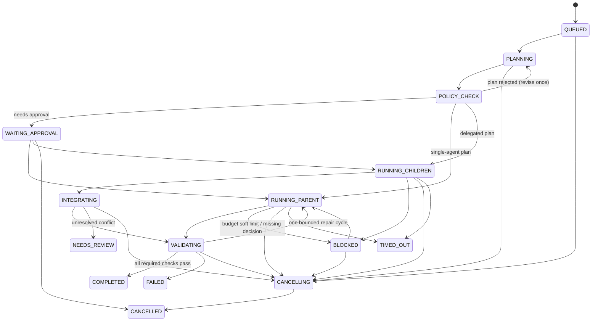

# Orchestration lifecycle (Phase 3 — in progress, milestone M1)

> Phase 3 started on 2026-10-11 (owner decision). ADR-0012 (Agent SDK), ADR-0013 (guardrails),
> ADR-0014 (budget) and ADR-0015 (chat storage) confirm and narrow this design. **§0 is what M1
> builds**; §2–§5 remain the target for later milestones. Mark sections [implemented] only when they
> work.

## 0. Milestone M1 (what is being built)

- **Shape.** One run per conversation in the control panel: a **lead** agent (chats with the owner,
  read-only in the project root, has the lead tools) and up to 3 **worker** agents (one task each, own
  worktree, no lead tools). There is no separate PLANNING/POLICY_CHECK step: every `start_agent`
  call is a plan step that the engine checks against policy before anything starts.
- **Run states (M1):** `QUEUED → RUNNING ⇄ BLOCKED → REVIEW → COMPLETED`, plus `FAILED`,
  `CANCELLING → CANCELLED` and `NEEDS_REVIEW` (after a restart). `REVIEW` = every worker stopped and
  the owner is reviewing; `COMPLETED` = the owner merged or discarded every worker's changes.
- **Agent states:** `QUEUED → STARTING → RUNNING ⇄ WAITING_APPROVAL`, `RUNNING → BLOCKED` (budget),
  and terminal `SUCCEEDED | FAILED | CANCELLED | TIMED_OUT | NEEDS_REVIEW`.
- **Integration (M1):** per-worker review in the panel (diff + changed files); Merge into a clean base
  branch or Discard, always by the owner (ADR-0013). No automatic merging, no validation runner yet
  (P3-G).
- **Budget:** ADR-0014 budget tokens per agent; reaching the soft cap → `BLOCKED` + an approval of
  kind `budget-raise`.

## 1. Principles

- The LLM plans and recommends. **The engine enforces** concurrency, budgets, permissions, workspace
  isolation, cancellation, and validation. The model is never trusted to enforce its own limits.
- Success means the integrated result passes its required validation checks. A successful child does
  not mean the run succeeded.
- Every state transition is persisted before it is published.

## 2. Run state machine

Guarantees:

- Cancellation first stops new scheduling, then aborts active work (the Agent SDK uses
  `AbortController`). Cancelling a parent cancels its children.
- After a restart the engine resumes from persisted state. It **never automatically relaunches**
  non-idempotent agent work; it marks that work `NEEDS_REVIEW` instead.
- A missing heartbeat never implies success.

## 3. Structured plan (validated before execution)

Required fields:

- summary;
- strategy (`single` | `delegated`) and the rationale;
- child tasks, each with id, role, objective, expected outputs, read/write scope, and dependencies;
- integration strategy;
- validation strategy.

The engine rejects a plan that has:

- more than 3 children;
- a delegation depth above 1;
- a dependency cycle;
- overlapping write scopes without isolation;
- missing required fields.

## 4. Budget (open question Q1 — must be resolved before Phase 3)

The draft brief proposes a 50,000-token soft budget per run. **Local data shows cache-read tokens in the
billions for long sessions.** A single turn re-reads the full context. A budget that counts cache reads
would be used up almost at once. Options to decide by ADR, using Phase 1 and 2 measurements:

1. Budget output plus uncached input tokens. Track cache reads separately.
2. Budget estimated USD from a versioned pricing table (all categories priced correctly).
3. Separate per-category limits.

Whichever option is chosen, the budget is a _soft_ limit. Calls already in flight may overshoot, and
the overshoot is reported.

## 5. Workspace isolation

- Each concurrent child that can write gets its own `git worktree`. Exploration agents get read-only
  workspaces where feasible.
- The main workspace stays protected during parallel work.
- The engine collects a patch and a changed-file manifest from each child. It detects overlapping
  files and integrates deliberately.
- Final validation runs on the integrated tree.

## 6. Provider-internal subagents

A parent may use Claude Code's own subagents. The engine **observes** them through the Phase 1
observation pipeline (subagent edges, usage), but does not claim to control them.
