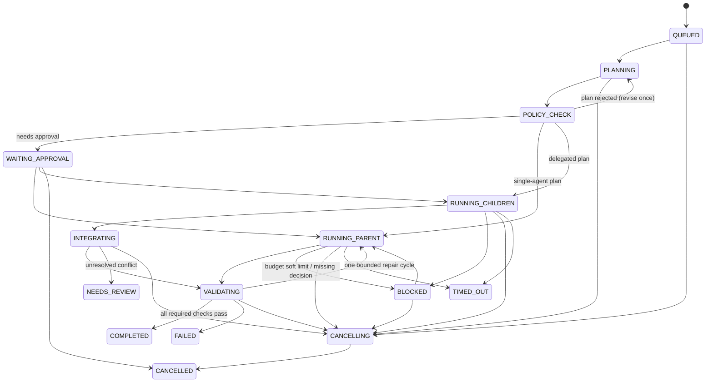

# Orchestration lifecycle (Phase 3 — in progress, milestone M1)

> Phase 3 started on 2026-10-11 (owner decision). ADR-0012 (Agent SDK), ADR-0013 (guardrails),
> ADR-0014 (budget) and ADR-0015 (chat storage) confirm and narrow this design. **§0 is what M1
> builds**; §2–§5 remain the target for later milestones. Mark sections [implemented] only when they
> work.

## 0. Milestone M1 (what is being built)

- **Shape.** One run per conversation in the control panel: a **lead** agent (chats with the owner,
  read-only in the project root, has the lead tools) and up to 3 **worker** agents (one task each, own
  worktree, no lead tools). There is no separate PLANNING/POLICY_CHECK step: every `start_agent`
  call is a plan step that the engine checks against policy before anything starts.
- **Run states (M1):** `QUEUED → RUNNING ⇄ BLOCKED → REVIEW → COMPLETED`, plus `FAILED`,
  `CANCELLING → CANCELLED` and `NEEDS_REVIEW` (after a restart). `REVIEW` = every worker stopped and
  the owner is reviewing; `COMPLETED` = the owner merged or discarded every worker's changes.
- **Agent states:** `QUEUED → STARTING → RUNNING ⇄ WAITING_APPROVAL`, `RUNNING → BLOCKED` (budget),
  and terminal `SUCCEEDED | FAILED | CANCELLED | TIMED_OUT | NEEDS_REVIEW`.
- **Integration (M1):** per-worker review in the panel (diff + changed files); Merge into a clean base
  branch or Discard, always by the owner (ADR-0013). No automatic merging, no validation runner yet
  (P3-G).
- **Budget:** ADR-0014 budget tokens per agent; reaching the soft cap → `BLOCKED` + an approval of
  kind `budget-raise`.

> **Since ADR-0021 (2026-10-17), ticket runs use the review loop in §0.1.** §0's per-worker owner
> merge still describes control-panel runs and ticket runs started before it.

## 0.1 Approval modes, review loop and ticket branch (ADR-0021) [implemented]

Verified with fake agents against the real server, real git and real harness checks (server tests in
`packages/server/tests/{board,verification/review-loop}` and the browser flow
`packages/web/e2e/review-loop-live.spec.ts`). A consented real run on
2026-10-17 found two bugs ([research note](research/rl-v-real-run-2026-10-17.md)), since fixed;
the real runs of 2026-10-21 passed with every review route
([research note](research/wg-v-real-run-2026-10-21.md)).

- **Approval modes, snapshotted per run.** The project's mode (Workflow → Helpers → Approvals) is
  the default; the Start dialog can override it, the reviewer and the rework limit for one run.
  Only helpers and the tester are covered; the lead never approves tool requests.
  - _Manual:_ every edit and command asks the owner, harness checks too.
  - _Auto edits_ (default for new projects): an Edit/Write whose real path is inside the helper's
    own worktree (not under `.git` or `.claude`) and a Bash command that exactly matches a harness
    check run unasked.
  - _Auto:_ Auto edits plus the project's command allowlist (safe tokens only, a bare first word,
    `git` read-only). Each auto-approved request is recorded with its rule (`allowRule`).
- **Plan approval** creates the ticket branch `acp/<KEY>` (or `acp/<KEY>-r<n>`) from the base
  branch. The lead hears of the approval only once the branch exists. Helpers and the tester start
  from the ticket branch tip, each in its own worktree. Plan steps name helper roles only.
- **A helper's turn ends:** the agent goes to `AWAITING_REVIEW` (no process, no helper slot), its
  worktree is committed (sealed) and the required checks run on that commit.
- **Review:** a read-only review agent (default; it gets a detached checkout of the sealed commit
  and a diff of at most 64 KiB in its brief, sent, never stored) or the lead reviews the oldest
  ready change first. The review agent's findings become a ticket comment.
- **The lead decides** with `merge_change`, `request_rework` (comments), `discard_change`
  (reason) or `ask_owner` (question):
  - merge: integrate the tip into the helper's worktree (a conflict is refused with the file
    names), require the required checks to have passed on that commit (or start them; the lead
    hears back), then advance the ticket branch by compare-and-swap and release the worktree;
  - rework: refused past the run's limit (2 by default), over budget or with no free slot; the
    helper resumes its session in the same worktree and its change is reviewed again;
  - ask the owner: the change is `needs-owner`, and only the owner decides it (merge, merge anyway
    with a reason, rework with a comment, discard), also past the rework limit.
- **Stored text:** the review agent's findings and the lead's and owner's notes are ticket
  comments. Each round and decision is a `change_reviews` row with no text (a note on a round the
  review agent commented on has its own row).
- **Handover:** `request_review` is refused while a helper works or a change is undecided. After
  it, no helper starts; the final code review and the unit tests (if on) run on the ticket branch
  while the lead stays live.
- **Hand-over prompt (RL-F):** when the lead has not handed over, every change is decided and no
  other agent works, the engine sends the lead one message with the counts (merged into the ticket
  branch, discarded, with no changes) asking it to call `request_review` or start helpers for
  missing work; with nothing merged it says so. It is sent once per such point, again only after
  new helper or reviewer work, never after the handover, and not with the owner's "Request
  changes" message. A BLOCKED lead gets it after its budget raise.
- **The owner merges once:** at `REVIEW` the checks run on the tip (a detached temporary
  checkout). The ticket-branch card shows the combined diff `base..tip` and those checks. Merge
  needs a clean owner tree on the base branch, an unmoved base and passed required checks, then
  `merge --ff-only` and the branch is deleted; the run is `COMPLETED` and the ticket Done. Merge
  anyway (with a reason), Request changes (back to the lead, the run returns to `RUNNING`), Discard
  and Update from the base (when the base moved) are the other actions.
- **Stops and restarts:** Stop all cancels waiting helpers and keeps the ticket branch (it can only
  be discarded). After a restart nothing relaunches: waiting helpers and reviewers become
  `NEEDS_REVIEW`, undecided changes `needs-owner`.

## 1. Principles

- The LLM plans and recommends. **The engine enforces** concurrency, budgets, permissions, workspace
  isolation, cancellation, and validation. The model is never trusted to enforce its own limits.
- Success means the integrated result passes its required validation checks. A successful child does
  not mean the run succeeded.
- Every state transition is persisted before it is published.

## 2. Run state machine

Guarantees:

- Cancellation first stops new scheduling, then aborts active work (the Agent SDK uses
  `AbortController`). Cancelling a parent cancels its children.
- After a restart the engine resumes from persisted state. It **never automatically relaunches**
  non-idempotent agent work; it marks that work `NEEDS_REVIEW` instead.
- A missing heartbeat never implies success.

## 3. Structured plan (validated before execution)

Required fields:

- summary;
- strategy (`single` | `delegated`) and the rationale;
- child tasks, each with id, role, objective, expected outputs, read/write scope, and dependencies;
- integration strategy;
- validation strategy.

The engine rejects a plan that has:

- more than 3 children;
- a delegation depth above 1;
- a dependency cycle;
- overlapping write scopes without isolation;
- missing required fields.

## 4. Budget (open question Q1 — must be resolved before Phase 3)

The draft brief proposes a 50,000-token soft budget per run. **Local data shows cache-read tokens in the
billions for long sessions.** A single turn re-reads the full context. A budget that counts cache reads
would be used up almost at once. Options to decide by ADR, using Phase 1 and 2 measurements:

1. Budget output plus uncached input tokens. Track cache reads separately.
2. Budget estimated USD from a versioned pricing table (all categories priced correctly).
3. Separate per-category limits.

Whichever option is chosen, the budget is a _soft_ limit. Calls already in flight may overshoot, and
the overshoot is reported.

## 5. Workspace isolation

- Each concurrent child that can write gets its own `git worktree`. Exploration agents get read-only
  workspaces where feasible.
- The main workspace stays protected during parallel work.
- The engine collects a patch and a changed-file manifest from each child. It detects overlapping
  files and integrates deliberately.
- Final validation runs on the integrated tree.

## 6. Provider-internal subagents

A parent may use Claude Code's own subagents. The engine **observes** them through the Phase 1
observation pipeline (subagent edges, usage), but does not claim to control them.
