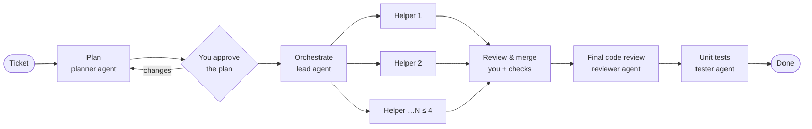

# Project workspace redesign — plan (draft for owner approval)

> Status: **plan only, nothing built yet** (2026-10-16). Owner decisions taken on 2026-10-16 are in §2.
> Once approved, this file becomes the entry point for the redesign work packages (R-*), with the
> same progress protocol as Phase 4 (`docs/phase-4/README.md` §9).

## 1. Why

The UI grew one page per phase. There are nine global sidebar entries (Board, Overview, Control panel,
Sessions, Tokens, Projects, Setup, Data health, plus a project list), and Board and Control panel show
overlapping run views. The owner wants:

- a **project-first** app: pick a project, then everything you see is about that project;
- fewer, clearer pages, and a more modern, friendlier look;
- **Skills** you can add and edit in the UI;
- an **Agent workflow** page: which agents take part, how many helpers can run, and how a ticket flows
  (plan → orchestrate → helpers → review and merge → final code review → unit tests), shown as a graph,
  with each agent mapped (or not) to a skill;
- a **Harness** page that answers "do we have a harness for this project, and does it pass?";
- a **Tokens** page per project: how many sessions, how many tokens, and new work vs cache reuse.

## 2. Owner decisions (2026-10-16)

| Topic                    | Decision                                                                                                                                                                                       |
| ------------------------ | ---------------------------------------------------------------------------------------------------------------------------------------------------------------------------------------------- |
| Skills                   | Real Claude Code skills, stored as files in the **project repo**: `.claude/skills/<name>/SKILL.md`. Agents load them natively, and they are versioned with the code.                           |
| Workflow                 | **Fixed stages, each configurable**, not a free-form graph editor. Each stage can be turned on or off, given a model, a skill and a limit.                                                     |
| Tokens "actual vs total" | **New work vs cache reuse.** New work is input + output tokens. The total also includes cache writes and cache reads. Both come from the same deduplicated usage, so nothing is counted twice. |
| P4-H                     | API-level verification now (in progress on `wp/p4-h-verify`). Browser tests are written against the new UI.                                                                                    |

## 3. Information architecture

```
┌──────────────────────────────────────────────────────────────────────────────┐
│ [AC] Agent Control Plane      [ ftl-rendering-harness ▾ ]          ⌘K   ☾   │  top bar: project switcher
├───────────────┬──────────────────────────────────────────────────────────────┤
│ PROJECT       │                                                              │
│  ▣ Board      │   page content                                               │
│  ⑂ Workflow   │                                                              │
│  ✦ Skills     │                                                              │
│  ✓ Harness    │                                                              │
│  ◔ Tokens     │                                                              │
│  ≡ Sessions   │                                                              │
│  ⚙ Settings   │                                                              │
│               │                                                              │
│ ───────────── │                                                              │
│  All projects │                                                              │
│  Data health  │                                                              │
└───────────────┴──────────────────────────────────────────────────────────────┘
```

- **Project switcher** in the top bar. It remembers the last project. "All projects" is the
  cross-project home: project cards with status, plus "New project".
- **Seven project pages:** Board, Workflow, Skills, Harness, Tokens, Sessions, Settings. There are no
  more global Overview, Control panel, Tokens or Setup entries.
- **The Control panel goes away as a page.** A run is always seen on its ticket page, which already
  shows the agent tree. Quick ad-hoc runs become "Quick ticket" on the board. Old `#/control/...`
  links redirect to the run's ticket or to the board.
- **Overview content moves:**
  - "Running now" and "Needs you" go to the board header.
  - The cross-project summary goes to "All projects".
- **Setup** (hooks and the data root) moves under Data health as "Connection".
- **Routes:**

  | Route                                       | Page         |
  | ------------------------------------------- | ------------ |
  | `#/p/:projectId/board`                      | Board        |
  | `#/p/:projectId/workflow`                   | Workflow     |
  | `#/p/:projectId/skills`, `…/skills/:name`   | Skills       |
  | `#/p/:projectId/harness`                    | Harness      |
  | `#/p/:projectId/tokens`                     | Tokens       |
  | `#/p/:projectId/sessions`, `#/sessions/:id` | Sessions     |
  | `#/p/:projectId/settings`                   | Settings     |
  | `#/p/:projectId/tickets/:ticketId`          | Ticket       |
  | `#/projects`, `#/projects/new`, `#/health`  | Global pages |

  Every old route redirects to its new home, so links in commit messages and notes still work.

## 4. Pages

### 4.1 Board (exists; simplify)

- Header: the project name, one line of live state ("2 running · 1 needs you"), and **New ticket**.
  The 7-day token tiles and the harness pill move to Tokens and Harness.
- Columns stay as built. The cancelled list stays collapsed.

### 4.2 Workflow (new) — "how agents work on a ticket"

A left-to-right graph (React Flow, already a dependency). Each node is a **stage**. Clicking a node
opens a side panel to configure it.



| Stage             | Agent                     | Configurable                                                                      | Default |
| ----------------- | ------------------------- | --------------------------------------------------------------------------------- | ------- |
| Plan              | planner (read-only)       | on (always), model, skill                                                         | on      |
| Orchestrate       | lead (read-only)          | model, skill                                                                      | on      |
| Helpers           | worker ×N (own worktrees) | max helpers (1–4), nesting depth (1–2), budget per agent, model, skill, allowlist | 3, 1    |
| Review & merge    | you + harness checks      | required checks block merge (from the harness)                                    | on      |
| Final code review | reviewer (read-only)      | on/off, model, skill; posts findings as ticket comments                           | off     |
| Unit tests        | tester (own worktree)     | on/off, model, skill; its tests go through the same review & merge                | off     |

- **Skill mapping is shown on each node.** Either "✦ code-review" or "No skill". Choosing a skill
  tells that stage's agent to use it.
- **The same graph, live, on the ticket page.** Nodes light up as the run passes through them, and the
  existing agent tree appears under the Helpers node.
- **Plan and Orchestrate as separate agents.** Today one lead agent does both. As separate stages,
  the planner writes and revises the plan, and the lead receives the approved plan and runs the
  helpers. A project can choose "same agent" (today's behavior) or "separate agents".

### 4.3 Skills (new)

- **List:** the skills in the project repo's `.claude/skills/*/SKILL.md`, as name, description, which
  workflow stages use it, last changed, and whether the file has uncommitted changes.
- **New skill and Edit skill:**
  - fields: name (a slug), description (when to use it), and instructions (Markdown, with a live
    preview);
  - a small template picker: code review, unit tests, plan, docs;
  - **Save** writes the file;
  - **Commit** creates a git commit with only that file, on the current branch (argv git, owner
    action).
- **Delete** removes the skill folder, with confirmation, and only when the skill is used by no stage.
- Only the project's own skills are shown. The app never reads or writes `~/.claude/skills`, the
  owner's personal skills (AGENTS.md rule 4).

### 4.4 Harness (moved and expanded)

- A status card: "No harness yet", "Invalid", "Partial" or "Ready", with plain-language problems.
- The list of checks, each with its command, folder, time limit and whether it is required.
- **Run checks now** on the main branch, with each result's output tail and a history of past runs.
- **Build the harness** creates the ticket when there is no harness, and shows its progress.
- Where the harness is used: which workflow stage runs which checks.

### 4.5 Tokens (project-scoped)

- **Headline tiles:**
  - sessions (count) and runs/tickets with agents;
  - **New work** (input + output);
  - **Total processed** (new work + cache write + cache read);
  - **Cache reuse share**: cache reads as a share of the total, with a one-line explanation of why it
    is large;
  - estimated cost (provider-reported, always labeled estimated, never summed across sessions).
- **Charts:** new work and cache over time, as two charts because the scales differ by about 1000×.
- **Breakdown tables:** by session, by ticket/run, by agent role (planner, lead, helper, reviewer,
  tester), and by model.
- **Rules kept:**
  - unavailable means "unavailable", never 0;
  - direct and aggregate usage are shown side by side;
  - provenance badges stay.

### 4.6 Sessions (project-scoped)

This is today's Sessions page and family tree, filtered to the project. The session detail page is
unchanged.

### 4.7 Settings (simplified)

- Project name and folder, and the board key.
- Context files.
- The danger zone.
- Agent limits and the allowlist move to **Workflow**, where they are used.

## 5. Visual refresh (applies to all pages)

- **One page header pattern:** title, one-line description, primary action on the right. One
  card style, one table style, one empty-state pattern with an illustration and a single action.
- **Calmer density:**
  - 8-pt spacing;
  - larger section titles and fewer labels;
  - explanations in `(i)` tooltips instead of paragraphs;
  - icons on every nav entry, and the sidebar collapses to icons at ≤1280 px.
- **Refreshed tokens:**
  - neutral surfaces with a single accent;
  - softer borders and shadows;
  - status colors kept for meaning only;
  - light and dark checked at 1440 and 1024.
- **⌘K command palette:** jump to a project, ticket or page, and do New ticket or Run checks.
- `packages/web/DESIGN.md` is updated first (R-A). Every page WP follows it.

## 6. Backend changes (not only UI)

| Change                      | Why                                                                                                                                                                                                            | Where                                       |
| --------------------------- | -------------------------------------------------------------------------------------------------------------------------------------------------------------------------------------------------------------- | ------------------------------------------- |
| Workflow config per project | Stages on/off, models, skills, limits                                                                                                                                                                          | core contracts; db migration 0004; server   |
| New agent roles             | `planner`, `reviewer`, `tester` next to `lead` and `worker`                                                                                                                                                    | core `AgentRoleKind`; orchestrator; adapter |
| Stage sequencing            | After merge, optionally start the reviewer (read-only on the integrated branch) and the tester (own worktree; its change is reviewed and merged too)                                                           | orchestrator; server run service            |
| Skills API                  | `GET/POST/PUT/DELETE /api/projects/:id/skills[/:name]`, plus `POST …/:name/commit`. Writes are limited to `<repo>/.claude/skills/<slug>/SKILL.md`, with realpath containment, no symlinks, a size cap and CSRF | server; core DTOs                           |
| Skill use by agents         | A stage's skill is named in that agent's instructions ("Use the `<name>` skill"). Claude Code loads project skills itself                                                                                      | adapter (managed)                           |
| Project tokens summary      | Sessions count, new work vs total, by role, ticket and model                                                                                                                                                   | db queries; server; core DTO                |
| Persist audit fields        | `approvals.decided_by` and run limits (proposed 0004 from P4-D review)                                                                                                                                         | db migration 0004                           |

**New ADRs (written in R-0):**

- **ADR-0018, project skills written by the app.** It amends AGENTS.md rule 6, which forbids
  modifying Claude Code configuration. Skills are not settings, but they change what agents do, so the
  exception must be explicit: only `.claude/skills/<slug>/SKILL.md` in a registered project, only on
  an owner action, never `settings*.json`, and never `~/.claude`.
- **ADR-0019, workflow stages and the new roles.** It covers stage order, what each role may do
  (read-only vs worktree), how the reviewer's findings are stored (ticket comments, ADR-0016
  scope), and budgets per stage.

## 7. Work packages (proposed)

| WP      | What                                                                                                                                        | Depends  | Notes                           |
| ------- | ------------------------------------------------------------------------------------------------------------------------------------------- | -------- | ------------------------------- |
| **R-0** | Coordinator: ADR-0018/0019; contracts (workflow config, roles, skills DTOs, tokens summary DTO); migration 0004 spec; DESIGN.md update      | approval | Like P4-0                       |
| **R-A** | Shell and navigation: top-bar project switcher, project sidebar, new routes and redirects, All projects page, ⌘K palette, visual tokens     | R-0      | Unblocks every page             |
| **R-B** | Workflow page (graph, stage panel)                                                                                                          | R-0, R-A | UI                              |
| **R-C** | Engine: planner/lead split, reviewer and tester stages, workflow-driven limits                                                              | R-0      | Orchestrator plus adapter       |
| **R-D** | Skills: server API with file safety, plus the Skills page                                                                                   | R-0, R-A | Server and UI; one agent or two |
| **R-E** | Harness page                                                                                                                                | R-A      | Mostly moves existing parts     |
| **R-F** | Tokens: db queries, server route, and page                                                                                                  | R-0, R-A |                                 |
| **R-G** | Server wiring: workflow config routes, migration 0004, stage sequencing in the run service, live stage state on the ticket                  | R-0, R-C |                                 |
| **R-H** | Board, ticket and settings simplification; live workflow graph on the ticket page                                                           | R-A, R-G |                                 |
| **R-V** | Verification: browser e2e for the new UI (including P4-H's deferred `workspace.spec.ts`), screenshots, then one real smoke run with consent | all      |                                 |

**Waves:** R-0 → (R-A, R-C in parallel) → (R-B, R-D, R-E, R-F, R-G in parallel) → R-H → R-V.

## 8. Risks and open points

- **The engine change is the big piece.** The planner/lead split and two extra stages touch the state
  machine. Mitigation: today's single-lead flow stays the default until R-C's tests cover each new
  path.
- **Skill file writes reach the owner's working tree**, the first app write outside agent worktrees.
  Mitigation: a strict path rule, an owner click per write, and a visible "uncommitted" state
  (ADR-0018).
- **"Unit tests" stage vs harness checks:** the tester _writes_ tests, while the harness _runs_
  checks. The UI must make that difference obvious.
- **Ticket page density:** the live graph plus the agent tree must stay readable with 4 helpers ×
  depth 2. Screenshots gate R-H.
